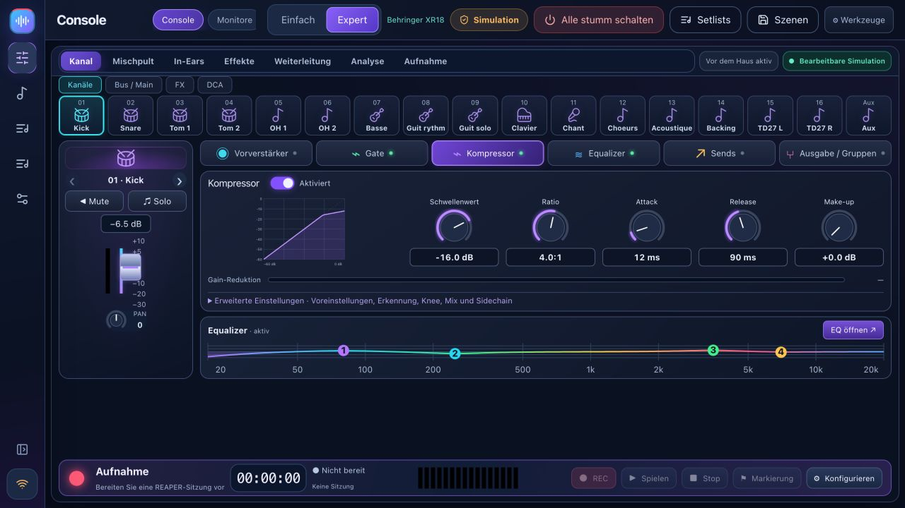

# BandPilot

**Deine Band. Dein Mischpult. Dein Sound.**

[Download](https://github.com/herve8940/BandPilot/releases/latest) · [Website](https://herve8940.github.io/BandPilot/de.html) · [Vollständiger Leitfaden](docs/USER_GUIDE_DE.md) · [Français](README.md) · [Videotour](https://herve8940.github.io/BandPilot/VIDEO_TOUR.html)

BandPilot ist der neue Name von XR18 Studio: eine kostenlose lokale App für geführte Soundchecks, visuelle Mischpult-Steuerung, persönliche Monitorsteuerung am Telefon und REAPER-Proben. Windows, Intel/Apple Silicon macOS und Linux.

**Mehrsprachige App: Englisch, Französisch, Italienisch, Spanisch und Deutsch.** Wählen Sie Ihre Sprache unter **Einstellungen → Optionen · Sprache**; Ihre Auswahl wird auf diesem Gerät gespeichert. Musiker können auf ihren Telefonen ihre eigene Sprache wählen. Weitere Sprachen können auf Anfrage hinzugefügt werden.

[Français](README.md) · [English](README.en.md) · [Italiano](README.it.md) · [Español](README.es.md) · [Deutsch](README.de.md)

## Funktionen
- Sechs-Schritte-Coach: Anschließen, Eingänge konfigurieren, Verstärkung messen, Fehler beheben, Monitore vorbereiten und speichern. Es liest Messungen, keine Audiodaten.
- Mischpult im einfachen und im Expertenmodus, kompakte Seitenleiste, Kanalbänke, EQ/Gate/Komprimierung/Sends/Busse/DCAs/FX/Routing, wie vom Modell unterstützt.
- Persönliche QR-Monitor-Links, Nur-Bus-Steuerungen, gespeicherte Profile und Pegelgrenzen und schrittweise Pegelerhöhungen.
- REAPER-Songs/Band-Probe: Abschnitte, gültige Takes, Wellenformen, projektbewusste Präsenz, Originalwiedergabe, Loops und Aufnahmemarkierungen.
- Showvorbereitung, Songbibliothek, Setlisten, dauerhafte Probennotizen, Szenen-JSON-Import/Export, Vorschauen und Backups.
- Modellbewusste Erkennung, schreibgeschützte Erstverbindung, optionale Konten, Diagnose und optional verbundene KI mit Ihrem eigenen Schlüssel.

Lokaler Betrieb erfordert kein Konto oder Internet; Mischpult, Computer und Telefone teilen sich ein Netzwerk. REAPER ist eine separate Software mit eigener Lizenz. Vernetzte KI ist optional und erfordert Internet.

## Kompatibilität ist modellspezifisch

**XR18** ist das am Gerät getestete Primärmodell. **X18/MR18** teilen Profile/Protokoll, benötigen aber dennoch eine eigene Hardwarevalidierung. **XR12/MR12** verfügen über angepasste 12-Eingangsprofile, 4 Mikrofonvorverstärker und 2 physische Aux-Ausgänge: Stereo-USB-Stick-Aufnahme, **kein PC-Multitrack-USB**. Die Hardwarevalidierung steht noch aus.

**X32-Varianten sind partiell und experimentell**: Mischen, EQ, Kerndynamik und Sends. Die vollständige Vorverstärker-/Routing-/FX-/Meter-/Szenen-/Coach-/Monitorsteuerung am Telefon-/USB-Integration ist weiterhin nicht verfügbar. Lesen Sie die [Matrix](docs/multi-model.md) vor dem Live-Einsatz.

## Fangen Sie an

Sichern Sie Szenen, installieren Sie das passende Paket, erkunden Sie die Simulation, entdecken Sie die schreibgeschützte Hardware und ziehen Sie dann **Mischpult → PC**, bevor Sie die Steuerung aktivieren. Folgen Sie dem [illustrierten Coach-Tutorial](docs/TUTO_MON_INGE_SON_DE.md). Installieren Sie Bridge **1.2.3** von Rehearse, speichern Sie Projekte und starten Sie REAPER neu. Die Mischpultsimulation simuliert keine REAPER-Audioeingänge. Pakete können nicht signiert/nicht notariell beglaubigt sein.

[Illustriertes Video und Transkript](docs/VIDEO_TOUR.md) · [Versionshinweise](docs/RELEASE_NOTES.md) · [Manuelle Korrekturen](docs/corrections-tests-manuels.md)

## Entwicklung und Validierung

Node.js 20+ (CI/Pakete: Node.js 22). `npm ci`, `npm --prefix web ci`, `npm run studio`; prüft: `npm test`, `npm run test:web`, `npm run build:all`; Pakete: `npm run desktop:package`.

Backend-Tests und React-Regressionen decken OSC, Szenen, FX, Konten, Monitore, REAPER/Lua und Modellprofile ab. Sie zertifizieren nicht die akustischen Ergebnisse oder jedes Hardwaremodell. Pakete werden nach Plattformprüfungen gemeinsam mit SHA-256-Prüfsummen veröffentlicht. Aus Kompatibilitätsgründen bleiben alte Datenbezeichner und REAPER-Pfade erhalten.

Unabhängiges MIT-Projekt, nicht verbunden mit Behringer, Midas oder Music Tribe. Marken gehören ihren Eigentümern.

Startup-Fix: [Anschlussfeld 2.2.1](docs/hotfix-2.2.1.md).

## BandPilot 2.2.2

[Persönliche Layouts und Monitorpult](docs/WORKSPACES.md#english): modell-/bildschirmspezifische Layouts, Mix/EQ/Komprimierung pro Musiker und Signalpfade. Enthält den [REAPER Bridge 1.2.3 Fix](docs/hotfix-2.2.2.md).
