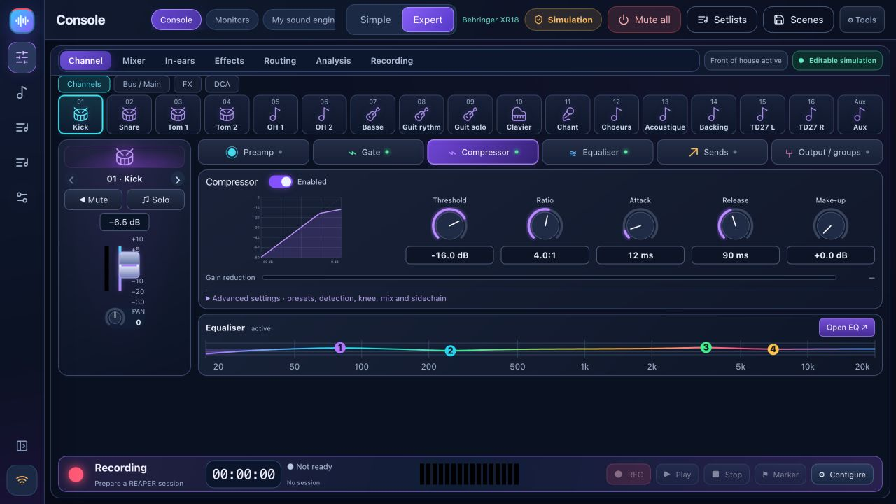

# BandPilot

**Your band. Your mixer. Your sound.**

[Download](https://github.com/herve8940/BandPilot/releases/latest) · [Website](https://herve8940.github.io/BandPilot/en.html) · [Full guide](docs/USER_GUIDE_EN.md) · [Français](README.md) · [Video tour](https://herve8940.github.io/BandPilot/VIDEO_TOUR.html)

BandPilot is the new name of XR18 Studio: a free local app for guided sound checks, visual mixer control, personal phone monitors and REAPER rehearsals. Windows, Intel/Apple Silicon macOS and Linux.

**Multilingual app: English, French, Italian, Spanish and German.** Select your language in **Settings → Options · Language**; your choice is saved on this device. Musicians can choose their own language on their phones. More languages can be added on request.

[Français](README.md) · [English](README.en.md) · [Italiano](README.it.md) · [Español](README.es.md) · [Deutsch](README.de.md)

## Features

- Six-step coach: connect, configure inputs, measure gain, troubleshoot, prepare monitors and save. It reads measurements, not audio.
- Simple and Expert mixer, compact sidebar, channel banks, EQ/gate/compression/sends/buses/DCAs/FX/routing as supported by the model.
- Personal QR monitor links, bus-only controls, saved profiles and progressive capped levels.
- REAPER songs/band rehearsal: sections, valid takes, waveforms, project-aware presence, original playback, loops and recording markers.
- Show preparation, song library, setlists, persistent rehearsal notes, scene JSON import/export, previews and backups.
- Model-aware discovery, read-only initial connection, optional accounts, diagnostics and optional connected AI with your own key.

Local operation needs no account or internet; mixer, computer and phones share a network. REAPER is separate software with its own license. Connected AI is optional and requires internet.

## Compatibility is model-specific

**XR18** is the physically tested primary model. **X18/MR18** share profiles/protocol but still need their own hardware validation. **XR12/MR12** have adapted 12-input profiles, 4 mic preamps and 2 physical Aux outputs: stereo USB-stick recording, **no PC multitrack USB**. Hardware validation remains pending.

**X32 variants are partial and experimental**: mixing, EQ, core dynamics and sends. Full preamp/routing/FX/meters/scenes/coach/phone-monitor/USB integration remains unavailable. Read the [matrix](docs/multi-model.md) before live use.

## Get started

Back up scenes, install the matching package, explore simulation, discover hardware read-only, then pull **Mixer → PC** before enabling control. Follow the [illustrated coach tutorial](docs/TUTO_MON_INGE_SON_EN.md). Install bridge **1.2.3** from Rehearse, save projects and restart REAPER. Mixer simulation does not simulate REAPER audio inputs. Packages may be unsigned/unnotarized.

[Illustrated video and transcript](docs/VIDEO_TOUR.md) · [Release notes](docs/RELEASE_NOTES.md) · [Manual fixes](docs/corrections-tests-manuels.md)

## Development and validation

Node 20+ (CI/packages: Node 22). `npm ci`, `npm --prefix web ci`, `npm run studio`; checks: `npm test`, `npm run test:web`, `npm run build:all`; packages: `npm run desktop:package`.

Backend tests and React regressions cover OSC, scenes, FX, accounts, monitors, REAPER/Lua and model profiles. They do not certify acoustic results or every hardware model. Packages are published together after platform checks, with SHA-256 checksums. Legacy data identifiers and REAPER paths remain for compatibility.

Independent MIT project, not affiliated with Behringer, Midas or Music Tribe. Trademarks belong to their owners.

Startup fix: [connection panel 2.2.1](docs/hotfix-2.2.1.md).

## BandPilot 2.2.2

[Personal layouts and monitor desk](docs/WORKSPACES.md#english): model/screen-specific layouts, per-musician mix/EQ/compression and signal paths. Includes the [REAPER bridge 1.2.3 fix](docs/hotfix-2.2.2.md).
