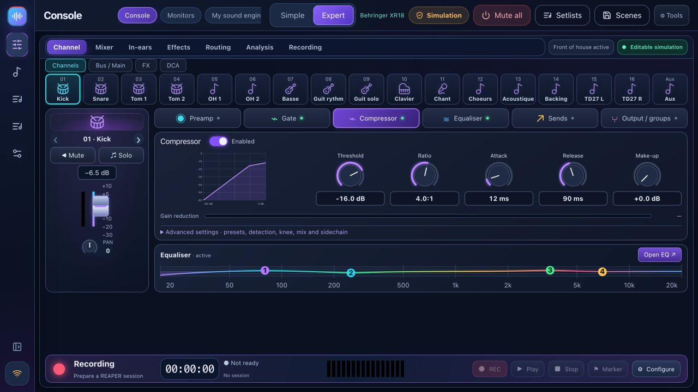

# BandPilot

<!-- community-badge:start -->

<!-- community-badge:end -->

**Your band. Your mixer. Your sound.**

[Download](https://herve8940.github.io/BandPilot/en.html#download) · [Website](https://herve8940.github.io/BandPilot/en.html) · [Full guide](docs/USER_GUIDE_EN.md) · [Français](README.md) · [Video tour](https://herve8940.github.io/BandPilot/VIDEO_TOUR.html)

BandPilot is a free local app for Behringer X-Air and Midas M-Air mixer control, guided sound checks, personal monitor mixes and REAPER rehearsals on desktop. Windows, macOS, Linux and standalone Android. BandPilot is the new name of XR18 Studio.

**Multilingual app: English, French, Italian, Spanish and German.** Select your language in **Settings → Options · Language**; your choice is saved on this device. Musicians can choose their own language on their phones. More languages can be added on request.

[Français](README.md) · [English](README.en.md) · [Italiano](README.it.md) · [Español](README.es.md) · [Deutsch](README.de.md)

<!-- community:start -->

## The BandPilot community on Discord

A place for musicians to help each other with soundchecks, monitor mixes, rehearsals and recording. All instruments, bands and experience levels are welcome.

Ask questions, share your experience and suggest improvements to BandPilot. Chat in French or English.

**[Join the Discord](https://discord.gg/FtWwEPmwE7)** · [Explore the channels](docs/COMMUNITY_EN.md)

### Discord, right inside BandPilot

In the new releases, open “Help and issues” from the menu or Settings: get help in #entraide-help, read the getting-started guide, suggest ideas and report issues in #bugs-tests. The issue message includes the app version; review it, copy it and send it yourself in Discord. No logs or audio are attached automatically.

[Get help](https://discord.com/channels/1570533717917573260/1570534770297806888) · [Report an issue](https://discord.com/channels/1570533717917573260/1570534866049699882)
<!-- community:end -->

## Versions and availability

Desktop: [latest stable release](https://github.com/herve8940/BandPilot/releases/latest) (Windows, macOS, Linux). Android: **2.4.0-android.5 prerelease**, separate APK.

[Downloads and limitations](https://herve8940.github.io/BandPilot/en.html#download)

To separate instruments, work on lyrics and prepare songs for REAPER, discover [BandStudio](https://herve8940.github.io/BandStudio/en.html), an independent companion app.

## Mixer control, MIDI and phone rehearsals · 2.3.15

BandPilot 2.3.15 brings together new mixer controls, selective recall, software groups, MIDI and REAPER rehearsals on musicians’ phones.

- **Mixer and monitors** — Custom banks and surfaces, software groups, stereo pairs, meters and RTA. Available controls and destinations depend on the connected model and selected mix.
- **Scenes and presets** — Selective input, output and FX recall, protection by parameter family, preview and backup. Explicit preset and portable scene conversion within the supported X-Air/M-Air scope.
- **Effects and analysis** — Named editors for the 61 X-Air algorithms, tap tempo and 31-band GEQ/True EQ on supported outputs. Microphone measurements and correction proposals require user review and explicit application.
- **MIDI and commands** — Fader and mute learning, absolute or relative CC, notes, Program Change, favorite commands and conditions. Explicit session activation and backups for supported commands.
- **Rehearsal and song sheets** — Open REAPER project tabs, sections, loops, count-in, separate takes and a phone rehearsal manager. Compatible BandStudio song sheets provide chords and lyrics with an optional full-screen view.

This update concerns the Windows, Intel/Apple Silicon macOS and Linux desktop apps. Android remains a separate 2.4.0-android.5 release and does not include every desktop feature described here. BandStudio is an independent companion app.

[2.3.15 tutorial](docs/NEW_2_3_15_EN.md)
## New: technical rider, source ambience and Android

The first standalone Android version is available as a signed APK. No weekly re-signing is required. REAPER remains on desktop.

- **Technical rider and stage plot** — Prepare inputs, musicians, monitors and connections. Position the band on the stage plot, then print or export a PDF. A visible shortcut opens it from the sound coach.
- **Source ambience** — Choose effects suited to the voice or instrument, preview the trial and adjust the amount in each musician’s monitor. Keep the result or restore the previous settings.
- **Standalone Android** — Install the APK on a compatible tablet and connect directly to the mixer over Wi-Fi. The interface, engine and data run on the tablet: no PC or Docker required.

[Android APK](https://github.com/herve8940/BandPilot/releases/download/android-v2.4.0-android.5/BandPilot-Android-2.4.0-android.5-universal.apk) · [Android guide (FR)](docs/ANDROID.md)

Android version: 2.4.0-android.5. Android 8+ and Android System WebView 111+. Universal APK for ARM 32/64-bit and x86_64; portrait and landscape layouts. Installation and startup checked on a Xiaomi Redmi Pad running Android 14; operation confirmed by its user. Other tablets and mixer combinations still require validation. Devices using 16 KB memory pages are not certified. REAPER and its recording-based Workshop remain desktop features.

## Features

- Six-step coach: connect, configure inputs, measure gain, troubleshoot, prepare monitors and save. It reads measurements, not audio.
- Simple and Expert mixer, compact sidebar, channel banks, EQ/gate/compression/sends/buses/DCAs/FX/routing as supported by the model.
- Personal QR monitor links, bus-only controls, saved profiles and progressive capped levels.
- REAPER songs/band rehearsal: sections, valid takes, waveforms, project-aware presence, original playback, loops and recording markers.
- Show preparation, song library, setlists, persistent rehearsal notes, scene JSON import/export, previews and backups.
- Model-aware discovery, read-only initial connection, optional accounts, diagnostics and optional connected AI with your own key.

Local operation needs no account or internet; mixer, computer and phones share a network. REAPER is separate software with its own license. Connected AI is optional and requires internet.

## Compatibility is model-specific

**XR18** is the physically tested primary model. **X18/MR18** share profiles/protocol but still need their own hardware validation. **XR12/MR12** have adapted 12-input profiles, 4 mic preamps and 2 physical Aux outputs: stereo USB-stick recording, **no PC multitrack USB**. Hardware validation remains pending.

**X32 variants are partial and experimental**: mixing, EQ, core dynamics and sends. Full preamp/routing/FX/meters/scenes/coach/phone-monitor/USB integration remains unavailable. Read the [matrix](docs/multi-model.md) before live use.

## Get started

Back up scenes, install the matching package, explore simulation, discover hardware read-only, then pull **Mixer → PC** before enabling control. Follow the [illustrated coach tutorial](docs/TUTO_MON_INGE_SON_EN.md). Install bridge **1.5.0** from Rehearse, save projects and restart REAPER. Mixer simulation does not simulate REAPER audio inputs. Packages may be unsigned/unnotarized.

[Illustrated video and transcript](docs/VIDEO_TOUR.md) · [Release notes](docs/RELEASE_NOTES.md) · [Manual fixes](docs/corrections-tests-manuels.md)

## Development and validation

Node 20+ (CI/packages: Node 22). `npm ci`, `npm --prefix web ci`, `npm run studio`; checks: `npm test`, `npm run test:web`, `npm run build:all`; packages: `npm run desktop:package`.

Backend tests and React regressions cover OSC, scenes, FX, accounts, monitors, REAPER/Lua and model profiles. They do not certify acoustic results or every hardware model. Packages are published together after platform checks, with SHA-256 checksums. Legacy data identifiers and REAPER paths remain for compatibility.

Independent MIT project, not affiliated with Behringer, Midas or Music Tribe. Trademarks belong to their owners.

Startup fix: [connection panel 2.2.1](docs/hotfix-2.2.1.md).

## BandPilot 2.2.2

[Personal layouts and monitor desk](docs/WORKSPACES.md#english): model/screen-specific layouts, per-musician mix/EQ/compression and signal paths. Includes the [REAPER bridge 1.2.3 fix](docs/hotfix-2.2.2.md).

<!-- support:start -->
## Support BandPilot

More time playing, less time searching for a setting. BandPilot helps bands prepare their sound checks and keep familiar setups with a free, open tool.

Voluntary support helps make time for fixes, mixer testing and guides in five languages. Field reports, translations and sharing the project also help.

[Support on Ko-fi](https://ko-fi.com/bandpilot) · [Ways to help the project](docs/SUPPORT_EN.md) · [Contribute](CONTRIBUTING.md)
<!-- support:end -->

[Security](SECURITY.md) · [Data and privacy](docs/PRIVACY.md) · [Help](SUPPORT.md) · [MIT](LICENSE)
