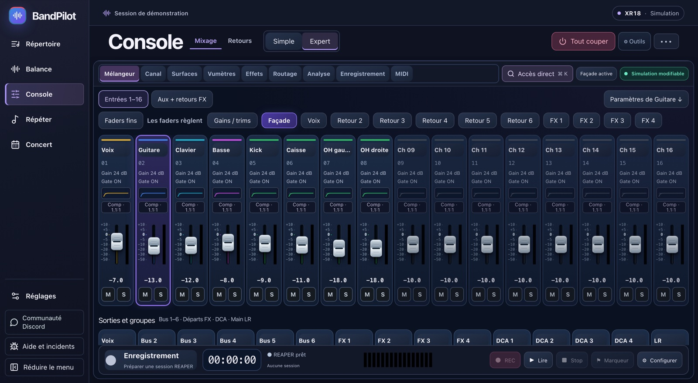
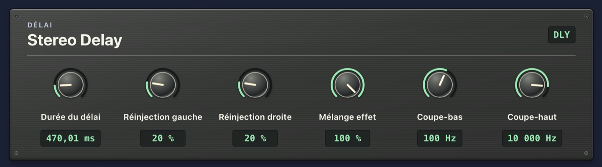

# BandPilot

[Français](README.md) · **English** · [Deutsch](README.de.md) · [Español](README.es.md) · [Italiano](README.it.md)

**From soundcheck to showtime.** Control your X-Air or M-Air mixer from a computer or Android tablet. Run soundcheck, set up each musician’s monitor mix and keep your setlist handy on stage.

[Download BandPilot](https://herve8940.github.io/BandPilot/en.html#download) · [Getting started](docs/USER_GUIDE_EN.md) · [Release notes](docs/RELEASE_NOTES.md#release-en)

[](https://herve8940.github.io/BandPilot/en.html#view-mixer)

## 61 effects in the rack

Each X-Air and M-Air effect has its own front panel. On Stereo Delay, turn the knobs to time the repeats to the song. In the mixer, grab the centre of an EQ point and drag it. Monitor mixes show the bus or profile name, with the share button right on the selected mix.

[](https://herve8940.github.io/BandPilot/en.html#news)

## Install BandPilot

| Desktop release 3.0.3 | Downloads |
| --- | --- |
| Windows | [Windows (.exe)](https://github.com/herve8940/BandPilot/releases/download/v3.0.3/BandPilot-Windows-3.0.3.exe) |
| macOS | [Apple Silicon](https://github.com/herve8940/BandPilot/releases/download/v3.0.3/BandPilot-macOS-3.0.3-arm64.dmg) · [Intel](https://github.com/herve8940/BandPilot/releases/download/v3.0.3/BandPilot-macOS-3.0.3-x64.dmg) |
| Linux | [AppImage](https://github.com/herve8940/BandPilot/releases/download/v3.0.3/BandPilot-Linux-3.0.3-x86_64.AppImage) · [Debian / Ubuntu](https://github.com/herve8940/BandPilot/releases/download/v3.0.3/BandPilot-Linux-3.0.3-amd64.deb) |

[All files and SHA-256 checksums](https://github.com/herve8940/BandPilot/releases/tag/v3.0.3)

**Standalone Android app.** On an Android tablet, the APK controls the mixer without a computer. For a personal monitor on a phone, just scan the QR code shared by your band. [Download the APK · 3.0.3-android.1](https://github.com/herve8940/BandPilot/releases/download/android-v3.0.3-android.1/BandPilot-Android-3.0.3-android.1-universal.apk)

## Your first soundcheck

1. Install BandPilot and open simulation mode to explore the controls.
2. Connect your computer and mixer to the same local network, then select the detected mixer.
3. Choose the instruments and check the inputs and monitor outputs before confirming the soundcheck.

Start with a blank scene or one you saved. When you confirm a fresh soundcheck with your band, unused inputs and their sends go silent. Preamp gain and phantom power stay as they are. Assign each musician an output. Under Monitors → Phones, share the QR code for their mix on the local network. Saving the lineup updates the links without changing the audio.

Arrange songs in rehearsal. At the gig, follow the setlist and open the PDF for the current song. On desktop, the REAPER bridge connects rehearsal projects to your repertoire. REAPER is a separate download.

[Guided soundcheck tutorial](docs/TUTO_MON_INGE_SON_EN.md) · [Official website](https://herve8940.github.io/BandPilot/en.html)

## Mixers

- **Behringer XR18 / X18 · Midas MR18** — Six physical Aux outputs for monitor mixes. The XR18 has been detected on hardware. The MR18 profile has been checked in simulation.
- **Behringer XR12 · Midas MR12** — Two physical Aux outputs for monitors. The USB recorder is stereo. Multitrack recording on a computer requires a different model.
- **Behringer X32 · Rack · Compact · Producer · Core** — Partial, experimental support. Basic mixing and bus sends are available. Full scenes and personal phone monitoring are still in development.

[Detailed compatibility matrix (FR)](docs/multi-model.md)

## Run the project locally

With Node.js 22.13 or later, run these commands from the repository root, then open the address printed by Vite.

```sh
npm run ci:deps
npm --prefix web ci
npm run studio
```

[Contribute](CONTRIBUTING.md) · [Report a problem](https://github.com/herve8940/BandPilot/issues/new/choose) · [MIT license](LICENSE)

<!-- community:start -->
## The BandPilot community on Discord

Ask questions, share your experience and suggest improvements to BandPilot. Chat in French or English.

[Join the Discord](https://discord.gg/FtWwEPmwE7) · [Explore the channels](docs/COMMUNITY_EN.md)
<!-- community:end -->

<!-- community-badge:start -->
[](https://discord.gg/FtWwEPmwE7)
<!-- community-badge:end -->

<!-- support:start -->
## Support BandPilot

Voluntary support helps make time for fixes, mixer testing and guides in five languages. Field reports, translations and sharing the project also help.

[Support on Ko-fi](https://ko-fi.com/bandpilot) · [Ways to help the project](docs/SUPPORT_EN.md) · [Contribute](CONTRIBUTING.md)
<!-- support:end -->
