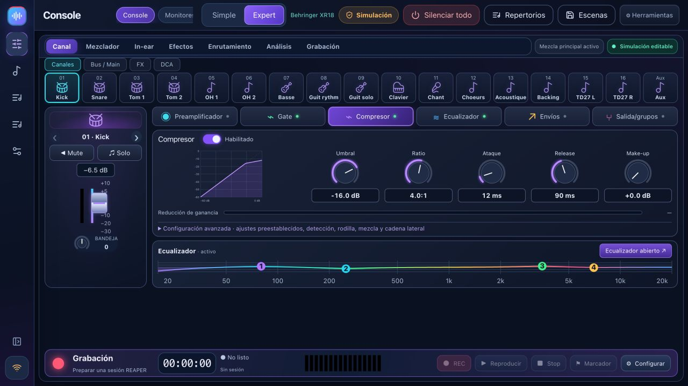

# BandPilot

**Tu banda. Tu mesa de mezclas. Tu sonido.**

[Descargar](https://github.com/herve8940/BandPilot/releases/latest) · [Sitio web](https://herve8940.github.io/BandPilot/es.html) · [Guía completa](docs/USER_GUIDE_ES.md) · [Français](README.md) · [Video tour](https://herve8940.github.io/BandPilot/VIDEO_TOUR.html)

BandPilot es el nuevo nombre de XR18 Studio: una aplicación local gratuita para pruebas de sonido guiadas, control visual de la mesa de mezclas, monitores telefónicos personales y ensayos de REAPER. Windows, Intel/Apple Silicon macOS y Linux.

**Aplicación multilingüe: inglés, francés, italiano, español y alemán.** Seleccione su idioma en **Configuración → Opciones · Idioma**; su elección se guarda en este dispositivo. Los músicos pueden elegir su propio idioma en sus teléfonos. Se pueden agregar más idiomas a pedido.

[Français](README.md) · [English](README.en.md) · [Italiano](README.it.md) · [Español](README.es.md) · [Deutsch](README.de.md)

## Novedades: ficha técnica, ambientes y Android

La primera versión Android autónoma está disponible como APK firmado. No requiere renovar la firma cada semana. REAPER sigue en el ordenador.

- **Ficha técnica y plano del escenario** — Prepara entradas, músicos, monitores y conexiones. Coloca al grupo en el plano e imprime o exporta un PDF. El acceso directo aparece en el asesor de sonido.
- **Ambientes de las fuentes** — Elige un efecto adecuado para la voz o el instrumento, revisa la propuesta y ajusta la cantidad en el monitor de cada músico. Conserva el resultado o recupera los ajustes anteriores.
- **Android autónomo** — Instala el APK en una tableta compatible y conéctala directamente a la mesa por Wi-Fi. La interfaz, el motor y los datos están en la tableta: sin PC ni Docker.

[Android APK](https://github.com/herve8940/BandPilot/releases/download/android-v2.4.0-android.1/BandPilot-Android-2.4.0-android.1-universal.apk) · [Guía Android (FR)](docs/ANDROID.md)

Primera versión: 2.4.0-android.1. Android 8+ y Android System WebView 111+. APK para ARM de 32/64 bits y x86_64; orientación vertical y horizontal. Instalación y arranque comprobados en Xiaomi Redmi Pad con Android 14; funcionamiento confirmado por su usuario. Otras tabletas y combinaciones con mesas requieren validación. Dispositivos con páginas de memoria de 16 KB no certificados. REAPER y el Taller basado en grabaciones siguen en el ordenador.

## Características

- Entrenador de seis pasos: conectar, configurar entradas, medir ganancia, solucionar problemas, preparar monitores y guardar. Lee medidas, no audio.
- Mesa de mezclas simple y experto, barra lateral compacta, bancos de canales, EQ/gate/compresión/envíos/buses/DCA/FX/enrutamiento según lo admita el modelo.
: enlaces de monitor QR personal, controles exclusivos de bus, perfiles guardados y niveles limitados progresivos.
- Canciones de REAPER/ensayo de banda: secciones, tomas válidas, formas de onda, presencia consciente del proyecto, reproducción original, bucles y marcadores de grabación.
- Preparación de espectáculos, biblioteca de canciones, listas de canciones, notas de ensayo persistentes, importación/exportación de escenas JSON, vistas previas y copias de seguridad.
: descubrimiento basado en el modelo, conexión inicial de solo lectura, cuentas opcionales, diagnóstico e IA conectada opcional con su propia clave.

La operación local no necesita cuenta ni Internet; Mesa de mezclas, computadora y teléfonos comparten una red. REAPER es un software independiente con su propia licencia. La IA conectada es opcional y requiere Internet.

## La compatibilidad es específica del modelo

**XR18** es el modelo primario probado físicamente. **X18/MR18** comparten perfiles/protocolo pero aún necesitan su propia validación de hardware. **XR12/MR12** tienen perfiles de 12 entradas adaptados, 4 preamplificadores de micrófono y 2 salidas auxiliares físicas: grabación en memoria USB estéreo, **sin USB multipista de PC**. La validación del hardware sigue pendiente.

**Las variantes de X32 son parciales y experimentales**: mezcla, ecualización, dinámica central y envíos. La integración completa de preamplificador/enrutamiento/FX/medidores/escenas/entrenador/monitor de teléfono/USB aún no está disponible. Lea la [matriz](docs/multi-model.md) antes del uso en vivo.

## Empezar

Haga una copia de seguridad de las escenas, instale el paquete correspondiente, explore la simulación, descubra el hardware de solo lectura y luego extraiga **Mixer → PC** antes de habilitar el control. Siga el [tutorial ilustrado del entrenador](docs/TUTO_MON_INGE_SON_ES.md). Instale bridge **1.2.3** desde Ensayo, guarde proyectos y reinicie REAPER. La simulación de la mesa de mezclas no simula las entradas de audio de REAPER. Los paquetes pueden no estar firmados ni notariados.

[Vídeo ilustrado y transcripción](docs/VIDEO_TOUR.md) · [Notas de la versión](docs/RELEASE_NOTES.md) · [Correcciones manuales](docs/corrections-tests-manuels.md)

## Desarrollo y validación

Nodo 20+ (CI/paquetes: Nodo 22). `npm ci`, `npm --prefix web ci`, `npm run studio`; comprobaciones: `npm test`, `npm run test:web`, `npm run build:all`; paquetes: `npm run desktop:package`.

Las pruebas de backend y las regresiones de React cubren OSC, escenas, FX, cuentas, monitores, REAPER/Lua y perfiles de modelos. No certifican los resultados acústicos ni todos los modelos de hardware. Los paquetes se publican juntos después de las comprobaciones de la plataforma, con sumas de comprobación SHA-256. Los identificadores de datos heredados y las rutas REAPER se mantienen por motivos de compatibilidad.

Proyecto independiente del MIT, no afiliado a Behringer, Midas o Music Tribe. Las marcas comerciales pertenecen a sus propietarios.

Corrección de inicio: [panel de conexión 2.2.1](docs/hotfix-2.2.1.md).

## BandPilot 2.2.2

[Diseños personales y escritorio de monitor](docs/WORKSPACES.md#english): diseños específicos de modelo/pantalla, mezcla/EQ/compresión por músico y rutas de señal. Incluye la [corrección REAPER bridge 1.2.3](docs/hotfix-2.2.2.md).
