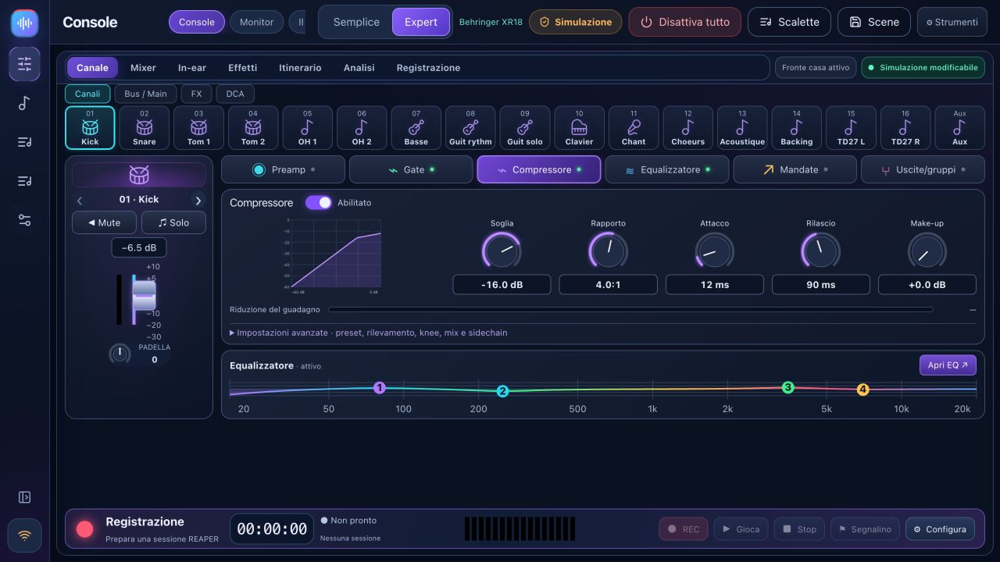

#BandPilot

**La tua band. Il tuo mixer. Il tuo suono.**

[Download](https://github.com/herve8940/BandPilot/releases/latest) · [Sito web](https://herve8940.github.io/BandPilot/it.html) · [Guida completa](docs/USER_GUIDE_IT.md) · [Français](README.md) · [Video tour](https://herve8940.github.io/BandPilot/VIDEO_TOUR.html)

BandPilot è il nuovo nome di XR18 Studio: un'app locale gratuita per sound check guidati, controllo visivo del mixer, monitor telefonici personali e prove REAPER. Windows, Intel/Apple Silicon macOS e Linux.

**App multilingue: inglese, francese, italiano, spagnolo e tedesco.** Seleziona la tua lingua in **Impostazioni → Opzioni · Lingua**; la tua scelta viene salvata su questo dispositivo. I musicisti possono scegliere la propria lingua sui propri telefoni. Su richiesta è possibile aggiungere altre lingue.

[Français](README.md) · [English](README.en.md) · [Italiano](README.it.md) · [Español](README.es.md) · [Deutsch](README.de.md)

## Caratteristiche

- Coach in sei fasi: connessione, configurazione degli ingressi, misurazione del guadagno, risoluzione dei problemi, preparazione dei monitor e salvataggio. Legge le misurazioni, non l'audio.
- Mixer semplice ed esperto, barra laterale compatta, banchi di canali, EQ/gate/compressione/mandate/bus/DCA/FX/routing come supportato dal modello.
- Collegamenti personali al monitor QR, controlli solo bus, profili salvati e livelli con limite progressivo.
- Canzoni/prove della band REAPER: sezioni, riprese valide, forme d'onda, presenza consapevole del progetto, riproduzione originale, loop e marcatori di registrazione.
- Preparazione dello spettacolo, libreria di brani, setlist, note di prova persistenti, importazione/esportazione JSON di scene, anteprime e backup.
- Rilevamento model-aware, connessione iniziale di sola lettura, account opzionali, diagnostica e intelligenza artificiale connessa opzionale con la tua chiave.

Il funzionamento locale non richiede account o Internet; mixer, computer e telefoni condividono una rete. REAPER è un software separato con la propria licenza. L'intelligenza artificiale connessa è facoltativa e richiede Internet.

## La compatibilità dipende dal modello

**XR18** è il modello principale testato fisicamente. **X18/MR18** condividono profili/protocollo ma necessitano comunque della propria convalida hardware. **XR12/MR12** hanno adattato profili a 12 ingressi, 4 preamplificatori microfonici e 2 uscite Aux fisiche: registrazione stereo su chiavetta USB, **nessuna USB multitraccia per PC**. La convalida dell'hardware rimane in sospeso.

**Le varianti X32 sono parziali e sperimentali**: mixaggio, EQ, dinamica di base e mandate. L'integrazione completa di preamplificatore/routing/FX/misuratori/scene/coach/monitor del telefono/USB non è disponibile. Leggere la [matrice](docs/multi-model.md) prima dell'uso dal vivo.

## Inizia

Effettua il backup delle scene, installa il pacchetto corrispondente, esplora la simulazione, scopri l'hardware di sola lettura, quindi seleziona **Mixer → PC** prima di abilitare il controllo. Segui il [tutorial illustrato per allenatori](docs/TUTO_MON_INGE_SON_IT.md). Installa il bridge **1.2.3** da Rehearse, salva i progetti e riavvia REAPER. La simulazione del mixer non simula gli ingressi audio REAPER. I pacchetti potrebbero non essere firmati/non autenticati.

[Video illustrato e trascrizione](docs/VIDEO_TOUR.md) · [Note sulla versione](docs/RELEASE_NOTES.md) · [Correzioni manuali](docs/corrections-tests-manuels.md)

## Sviluppo e validazione

Nodo 20+ (CI/pacchetti: Nodo 22). `npm ci`, `npm --prefix web ci`, `npm run studio`; controlli: `npm test`, `npm run test:web`, `npm run build:all`; pacchetti: `npm run desktop:package`.

I test di backend e le regressioni di React coprono OSC, scene, FX, account, monitor, REAPER/Lua e profili di modello. Non certificano i risultati acustici o ogni modello di hardware. I pacchetti vengono pubblicati insieme dopo i controlli della piattaforma, con checksum SHA-256. Gli identificatori di dati legacy e i percorsi REAPER rimangono per compatibilità.

Progetto indipendente del MIT, non affiliato con Behringer, Midas o Music Tribe. I marchi appartengono ai rispettivi proprietari.

Correzione all'avvio: [pannello di connessione 2.2.1](docs/hotfix-2.2.1.md).

##BandPilot 2.2.2

[Layout personali e console monitor](docs/WORKSPACES.md#english): layout specifici per modello/schermo, mix/equalizzazione/compressione per musicista e percorsi del segnale. Include la [correzione REAPER bridge 1.2.3](docs/hotfix-2.2.2.md).
