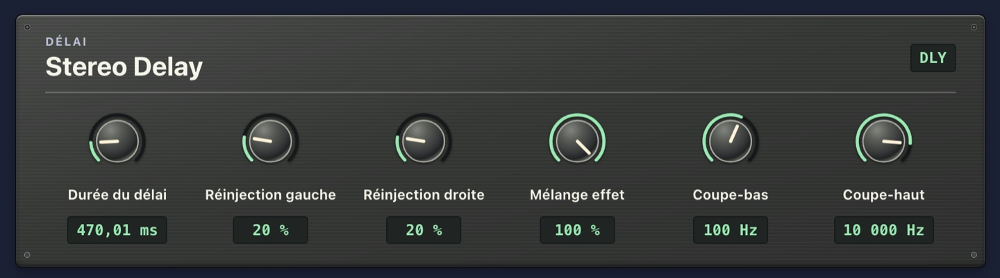

# BandPilot

[Français](README.md) · [English](README.en.md) · [Deutsch](README.de.md) · [Español](README.es.md) · **Italiano**

**Dal soundcheck al concerto.** Controlla il tuo mixer X-Air o M-Air da un computer o da un tablet Android. Prepara il soundcheck, regola il mix di monitoraggio di ogni musicista e tieni la scaletta a portata di mano sul palco.

[Scarica BandPilot](https://herve8940.github.io/BandPilot/it.html#download) · [Guida introduttiva](docs/USER_GUIDE_IT.md) · [Note di rilascio](docs/RELEASE_NOTES.md#release-it)

[](https://herve8940.github.io/BandPilot/it.html#view-mixer)

## 61 effetti nel rack

Ogni effetto X-Air e M-Air ha il proprio pannello. Con le manopole dello Stereo Delay puoi mettere le ripetizioni a tempo con il brano. Nel mixer puoi trascinare i punti dell’equalizzatore afferrandoli al centro. Ogni mix di monitoraggio mostra il nome del bus o del profilo e si condivide dalla scheda selezionata.

[](https://herve8940.github.io/BandPilot/it.html#news)

## Installa BandPilot

| Versione desktop 3.0.3 | Download |
| --- | --- |
| Windows | [Windows (.exe)](https://github.com/herve8940/BandPilot/releases/download/v3.0.3/BandPilot-Windows-3.0.3.exe) |
| macOS | [Apple Silicon](https://github.com/herve8940/BandPilot/releases/download/v3.0.3/BandPilot-macOS-3.0.3-arm64.dmg) · [Intel](https://github.com/herve8940/BandPilot/releases/download/v3.0.3/BandPilot-macOS-3.0.3-x64.dmg) |
| Linux | [AppImage](https://github.com/herve8940/BandPilot/releases/download/v3.0.3/BandPilot-Linux-3.0.3-x86_64.AppImage) · [Debian / Ubuntu](https://github.com/herve8940/BandPilot/releases/download/v3.0.3/BandPilot-Linux-3.0.3-amd64.deb) |

[Tutti i file e le somme SHA-256](https://github.com/herve8940/BandPilot/releases/tag/v3.0.3)

**App Android autonoma.** Su tablet Android l’APK controlla il mixer senza computer. Per il proprio mix monitor sul telefono basta scansionare il codice QR condiviso dal gruppo. [Scarica l’APK · 3.0.3-android.1](https://github.com/herve8940/BandPilot/releases/download/android-v3.0.3-android.1/BandPilot-Android-3.0.3-android.1-universal.apk)

## Il tuo primo soundcheck

1. Installa BandPilot e apri la simulazione per esplorare i comandi.
2. Collega il computer e il mixer alla stessa rete locale, poi seleziona il mixer rilevato.
3. Scegli gli strumenti e controlla gli ingressi e le uscite monitor prima di confermare il soundcheck.

Parti da una scena vuota o da una salvata. Quando confermi un nuovo soundcheck con il gruppo, gli ingressi inutilizzati e le rispettive mandate vengono silenziati. Il guadagno dei preamplificatori e l’alimentazione phantom restano invariati. Assegna un’uscita a ciascun musicista. In Monitor → Telefoni puoi condividere il codice QR per il suo mix sulla rete locale. Salvando la formazione aggiorni i link senza modificare l’audio.

Decidi l’ordine dei brani durante le prove. Sul palco puoi seguire la scaletta e aprire il PDF del brano in corso. Sul computer il bridge REAPER collega i progetti delle prove al repertorio. REAPER va scaricato separatamente.

[Tutorial sul soundcheck guidato](docs/TUTO_MON_INGE_SON_IT.md) · [Sito ufficiale](https://herve8940.github.io/BandPilot/it.html)

## Mixer

- **Behringer XR18 / X18 · Midas MR18** — Sei uscite Aux fisiche per i monitor. Il modello XR18 è stato rilevato su hardware reale. Il profilo MR18 è stato verificato in simulazione.
- **Behringer XR12 · Midas MR12** — Due uscite Aux fisiche per i monitor. Il registratore USB è stereo. Per registrare più tracce su computer serve un altro modello.
- **Behringer X32 · Rack · Compact · Producer · Core** — Supporto parziale e sperimentale. Sono disponibili il mixaggio di base e le mandate ai bus. Le scene complete e i monitor da telefono sono ancora in sviluppo.

[Matrice di compatibilità dettagliata (FR)](docs/multi-model.md)

## Avvia il progetto in locale

Con Node.js 22.13 o successivo, esegui questi comandi dalla radice del repository e poi apri l’indirizzo indicato da Vite.

```sh
npm run ci:deps
npm --prefix web ci
npm run studio
```

[Contribuisci](CONTRIBUTING.md) · [Segnala un problema](https://github.com/herve8940/BandPilot/issues/new/choose) · [Licenza MIT](LICENSE)

<!-- community:start -->
## La comunità BandPilot su Discord

Fai domande, condividi la tua esperienza e proponi miglioramenti a BandPilot. Conversazioni in francese o inglese.

[Entra nel Discord](https://discord.gg/FtWwEPmwE7) · [Scopri i canali](docs/COMMUNITY_IT.md)
<!-- community:end -->

<!-- community-badge:start -->
[](https://discord.gg/FtWwEPmwE7)
<!-- community-badge:end -->

<!-- support:start -->
## Sostieni BandPilot

Il sostegno volontario aiuta a dedicare tempo alle correzioni, alle prove sui mixer e alle guide in cinque lingue. Anche segnalazioni, traduzioni e condivisioni sono utili.

[Sostieni su Ko-fi](https://ko-fi.com/bandpilot) · [Come aiutare il progetto](docs/SUPPORT_IT.md) · [Contribuisci](CONTRIBUTING.md)
<!-- support:end -->
