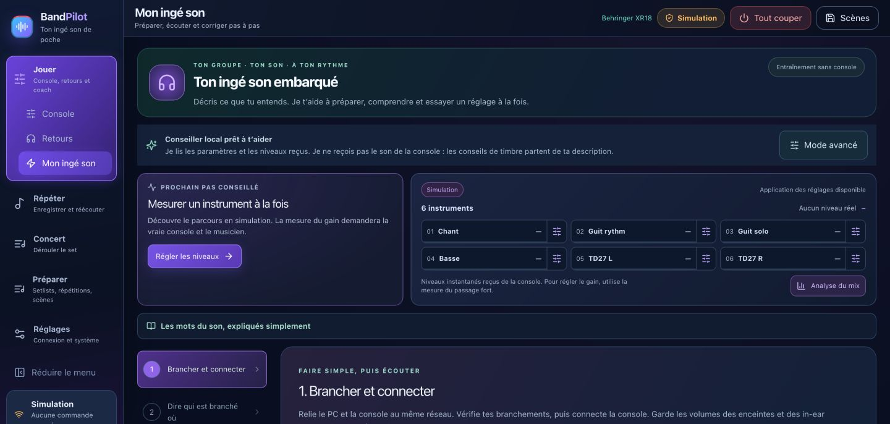
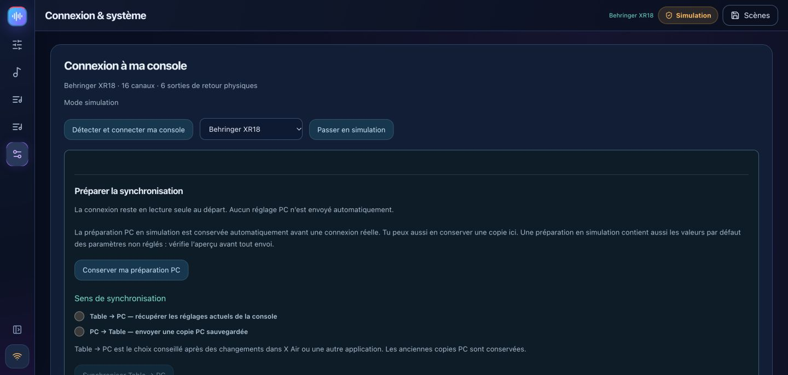
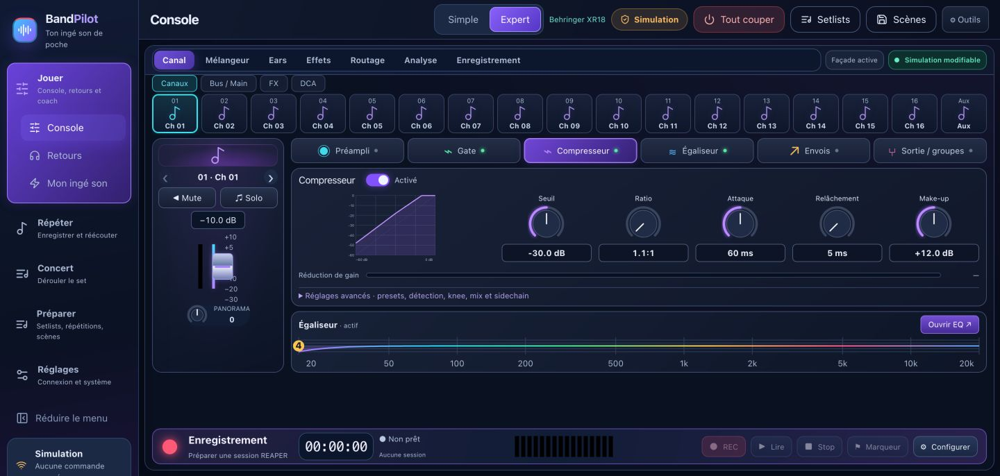
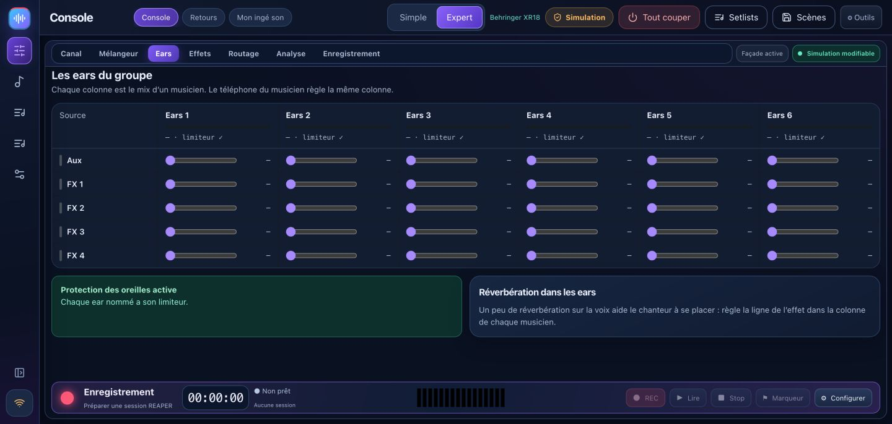
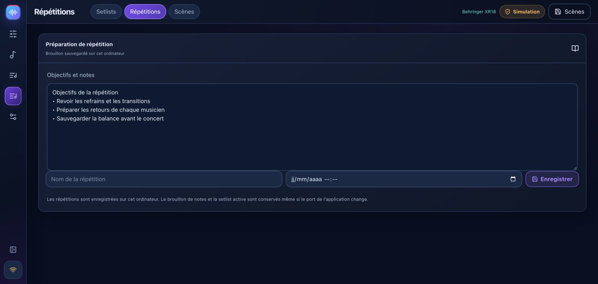

# BandPilot 2.2 — sound-check coach, step by step

[Français](TUTO_MON_INGE_SON.md) · [English](TUTO_MON_INGE_SON_EN.md) · [Italiano](TUTO_MON_INGE_SON_IT.md) · [Español](TUTO_MON_INGE_SON_ES.md) · [Deutsch](TUTO_MON_INGE_SON_DE.md)

[Français](TUTO_MON_INGE_SON.md) · [Full guide](USER_GUIDE_EN.md) · [Video tour](VIDEO_TOUR.md)

The coach supports your sound check. It does not receive audio or replace listening. This workflow is for supported X-Air/M-Air models, **not X32** in this release. New screenshots show simulation. Check the [hardware limits](multi-model.md). UI labels in the captures are French.

## 1. Connect

Keep outputs and headphones low. Connect computer and mixer to one local network. Discover the mixer in Settings, verify its model and start read-only. Pull **Mixer → PC** and save a backup scene. Enable control only for intended changes. Simulation is for exploration and does not produce real measurements.

## 2. Describe your inputs

Open the input configuration step. Choose a band template or add actual instruments and sockets. Check voice, bass, guitars and mono/stereo drum inputs. Detailed drums must follow real microphone wiring. Input and preamp limits depend on the model. A prepared band profile does not silently rename hardware.

Review high-pass, gate, EQ and compressor proposals. Thresholds depend on real input levels. The coach does not silently change phantom power.

## 3. Measure gain

Have one musician play their loudest expected passage. Start measurement. Repeat if data is missing, too quiet or too brief. Review the suggested gain and preview before applying, then measure again: the old measurement predates the change. A line input without a controllable mic preamp must not show a fabricated preamp control.

## 4. Listen and troubleshoot

Describe what you hear and change one thing at a time. If a proposal is incompatible with an EQ filter type, review the channel in Expert instead of forcing it.

Direct faders act immediately when control is enabled. Guided changes use preview, backup and undo. Undoing the last guided change is not a universal history of manual actions. Analysis and A/B comparisons require available hardware measurements and human listening. Optional connected AI requires your own key and internet; local advice remains available.

## 5. Prepare monitors

Add each musician, role, sources and bus. Verify physical sockets: XR18/MR18/X18 have six Aux outputs; XR12/MR12 have two despite their internal buses. Start pre-fader so main fader changes do not follow automatically into their ears.

Apply a starting mix at low levels, create personal links, start local sharing and scan each QR on the same network. Each musician controls only their bus. Save a profile if useful and stop sharing afterwards. Level caps and limiters do not by themselves guarantee safe listening levels.

## 6. Save your sound check

Save a named scene and export JSON as a backup. Verify model and synchronization direction before recall. Guided recall excludes phantom power by default and keeps a prior state. Complete X32 scenes and automatic cross-model conversions are unavailable.

Notes and active setlists stay in the application database even when the local port changes.

For recording and playback, follow [REAPER rehearsals](USER_GUIDE_EN.md#reaper). Mixer simulation does not simulate REAPER audio.
