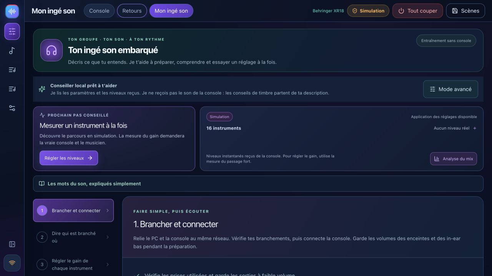
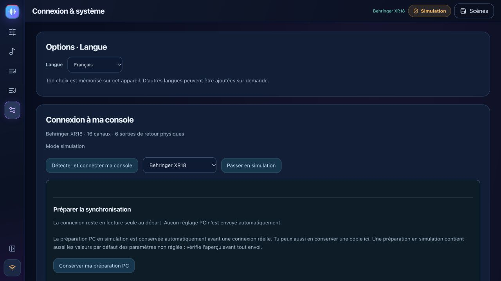
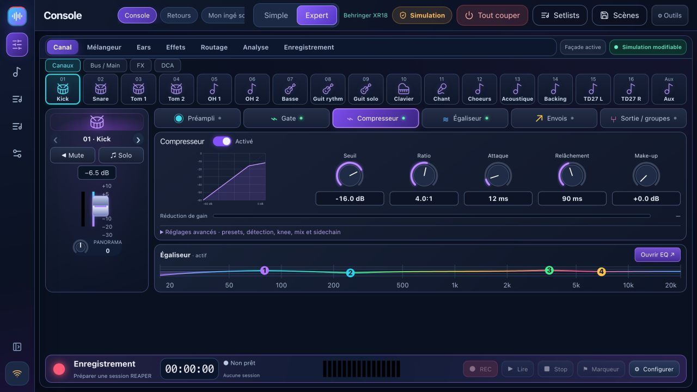
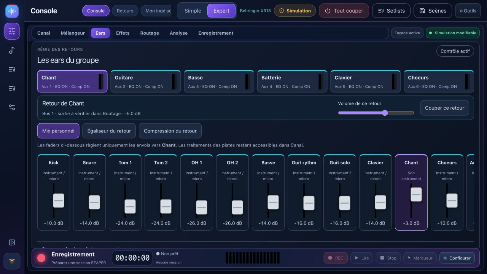
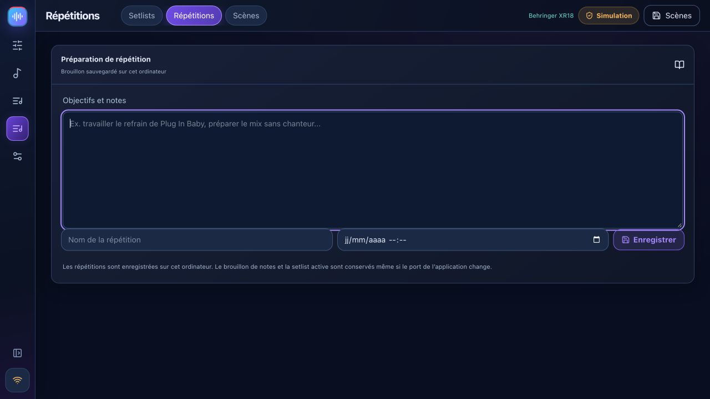

# BandPilot 2.2 — entrenador de prueba de sonido, paso a paso

[Français](TUTO_MON_INGE_SON.md) · [English](TUTO_MON_INGE_SON_EN.md) · [Italiano](TUTO_MON_INGE_SON_IT.md) · [Español](TUTO_MON_INGE_SON_ES.md) · [Deutsch](TUTO_MON_INGE_SON_DE.md)

[Français](TUTO_MON_INGE_SON.md) · [Guía completa](USER_GUIDE_ES.md) · [Video tour](VIDEO_TOUR.md)

El entrenador apoya tu prueba de sonido. No recibe audio ni reemplaza la escucha. Este flujo de trabajo es para los modelos X-Air/M-Air compatibles, **no X32** en esta versión. Nuevas capturas de pantalla muestran simulación. Verifique los [límites de hardware] (multi-model.md). Las etiquetas de la interfaz de usuario en las capturas son francesas.

## 1. Conectar

Mantenga las salidas y los auriculares bajos. Conecte la computadora y la mesa de mezclas a una red local. Descubra la mesa de mezclas en Configuración, verifique su modelo e inicie el modo de solo lectura. Tire de **Mixer → PC** y guarde una escena de respaldo. Habilite el control solo para los cambios previstos. La simulación es para exploración y no produce mediciones reales.

## 2. Describe tus aportaciones

Abra el paso de configuración de entrada. Elija una plantilla de banda o agregue instrumentos y enchufes reales. Verifique las entradas de voz, bajo, guitarras y batería mono/estéreo. Los tambores detallados deben seguir el cableado del micrófono real. Los límites de entrada y preamplificador dependen del modelo. Un perfil de banda preparado no cambia el nombre del hardware de forma silenciosa.

Revisar propuestas de paso alto, puerta, ecualizador y compresor. Los umbrales dependen de los niveles reales de entrada. El entrenador no cambia silenciosamente el poder fantasma.

## 3. Medir la ganancia

Haga que un músico toque el pasaje más alto esperado. Iniciar la medición. Repita si faltan datos, si son demasiado silenciosos o demasiado breves. Revise la ganancia sugerida y obtenga una vista previa antes de aplicarla, luego mida nuevamente: la medición anterior es anterior al cambio. Una entrada de línea sin un preamplificador de micrófono controlable no debe mostrar un control de preamplificador fabricado.

## 4. Escuche y solucione problemas

Describe lo que escuchas y cambia una cosa a la vez. Si una propuesta es incompatible con un tipo de filtro EQ, revisa el canal en Experto en lugar de forzarlo.

Los atenuadores directos actúan inmediatamente cuando el control está habilitado. Los cambios guiados utilizan vista previa, copia de seguridad y deshacer. Deshacer el último cambio guiado no es una historia universal de acciones manuales. Los análisis y las comparaciones A/B requieren mediciones de hardware disponibles y escucha humana. La IA conectada opcional requiere su propia clave e Internet; El asesoramiento local sigue estando disponible.

## 5. Preparar monitores

Agregue cada músico, rol, fuentes y bus. Verifique los enchufes físicos: XR18/MR18/X18 tienen seis salidas auxiliares; XR12/MR12 tienen dos a pesar de sus buses internos. Inicie el pre-fader para que los cambios del fader principal no lleguen automáticamente a sus oídos.

Aplique una combinación inicial en niveles bajos, cree enlaces personales, comience a compartir localmente y escanee cada QR en la misma red. Cada músico controla sólo su bus. Guarde un perfil si es útil y deje de compartirlo después. Los límites y límites de nivel no garantizan por sí solos niveles de escucha seguros.

## 6. Guarde su prueba de sonido

Guarde una escena con nombre y exporte JSON como copia de seguridad. Verifique el modelo y la dirección de sincronización antes de retirarlo. La recuperación guiada excluye la alimentación fantasma de forma predeterminada y mantiene un estado anterior. Las escenas X32 completas y las conversiones automáticas entre modelos no están disponibles.

Las notas y las listas de configuración activas permanecen en la base de datos de la aplicación incluso cuando cambia el puerto local.

Para grabación y reproducción, siga los [ensayos de REAPER](USER_GUIDE_ES.md#reaper). La simulación de la mesa de mezclas no simula el audio de REAPER.
