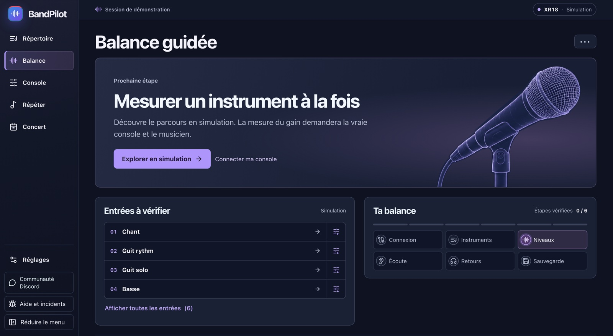
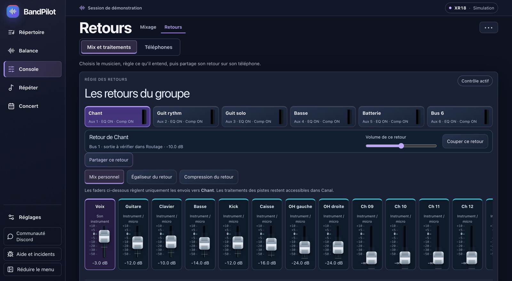

# BandPilot — coach per il soundcheck, passo dopo passo

[Français](TUTO_MON_INGE_SON.md) · [English](TUTO_MON_INGE_SON_EN.md) · [Italiano](TUTO_MON_INGE_SON_IT.md) · [Español](TUTO_MON_INGE_SON_ES.md) · [Deutsch](TUTO_MON_INGE_SON_DE.md)

Il coach guida il soundcheck sui mixer X-Air e M-Air compatibili in base alle impostazioni e alle misurazioni disponibili. Verifica il risultato all’ascolto. I passaggi seguenti riguardano questi modelli.

**BandPilot 3.0.0** · Parti da una scena vuota o da una salvata. Quando confermi un nuovo soundcheck con il gruppo, gli ingressi inutilizzati e le rispettive mandate vengono silenziati. Il guadagno dei preamplificatori e l’alimentazione phantom restano invariati.

Assegna un’uscita a ciascun musicista. In Monitor → Telefoni puoi condividere il codice QR per il suo mix sulla rete locale. Salvando la formazione aggiorni i link senza modificare l’audio.

[Guida introduttiva](USER_GUIDE_IT.md) · [Note di rilascio](RELEASE_NOTES.md#release-it) · [Matrice di compatibilità dettagliata (FR)](multi-model.md)

## 1. Connetti

Mantieni le uscite e le cuffie basse. Collega il computer e il mixer a una rete locale. Scopri il mixer in Impostazioni, verificane il modello e avvia in sola lettura. Seleziona **Mixer → PC** e salva una scena di backup. Abilita il controllo solo per le modifiche previste. La simulazione serve per l'esplorazione e non produce misurazioni reali.

## 2. Descrivi i tuoi input

Apre il passaggio di configurazione degli ingressi. Scegli un modello di banda o aggiungi strumenti e prese reali. Controlla voce, basso, chitarre e ingressi batteria mono/stereo. I tamburi dettagliati devono seguire il cablaggio del microfono reale. I limiti di ingresso e preamplificatore dipendono dal modello. Un profilo di banda preparato non rinomina automaticamente l'hardware.

Esamina le proposte passa-alto, gate, EQ e compressore. Le soglie dipendono dai livelli di input reali. Il coach non modifica silenziosamente l'alimentazione phantom.

## 3. Misurare il guadagno

Chiedi a un musicista di suonare il passaggio più rumoroso previsto. Avvia la misurazione. Ripetere se i dati mancano, sono troppo silenziosi o troppo brevi. Rivedi il guadagno suggerito e visualizza l'anteprima prima dell'applicazione, quindi misura di nuovo: la vecchia misurazione è precedente alla modifica. Un ingresso di linea senza preamplificatore microfonico controllabile non deve mostrare un controllo del preamplificatore fabbricato.

## 4. Ascolta e risolvi i problemi

Descrivi ciò che senti e cambia una cosa alla volta. Se una proposta è incompatibile con un tipo di filtro EQ, rivedi il canale in Esperto invece di forzarlo.

I fader diretti agiscono immediatamente quando il controllo è abilitato. Le modifiche guidate utilizzano l'anteprima, il backup e l'annullamento. L'annullamento dell'ultima modifica guidata non è una storia universale di azioni manuali. L'analisi e i confronti A/B richiedono misurazioni hardware disponibili e ascolto umano. L'intelligenza artificiale connessa opzionale richiede la tua chiave e Internet; la consulenza locale rimane disponibile.

## 5. Preparare i monitor

Aggiungi ogni musicista, ruolo, fonti e bus. Verificare le prese fisiche: XR18/MR18/X18 hanno sei uscite Aux; XR12/MR12 ne hanno due nonostante i bus interni. Avvia il pre-fader in modo che i cambiamenti del fader principale non seguano automaticamente le loro orecchie.

Applica un mix iniziale a livelli bassi, crea collegamenti personali, avvia la condivisione locale e scansiona ogni QR sulla stessa rete. Ogni musicista controlla solo il proprio bus. Salva un profilo se utile e interrompi la condivisione in seguito. I limiti e i limitatori di livello non garantiscono da soli livelli di ascolto sicuri.

## 6. Salva il tuo sound check

Salva una scena con nome ed esporta JSON come backup. Verificare il modello e la direzione di sincronizzazione prima del richiamo. Il richiamo guidato esclude l'alimentazione phantom per impostazione predefinita e mantiene uno stato precedente. Le scene X32 complete e le conversioni automatiche tra modelli non sono disponibili.

Le note e le setlist attive rimangono nel database dell'applicazione anche quando cambia la porta locale.

Per la registrazione e la riproduzione, seguire le [prove REAPER](USER_GUIDE_IT.md#reaper). La simulazione del mixer non simula l'audio REAPER.
