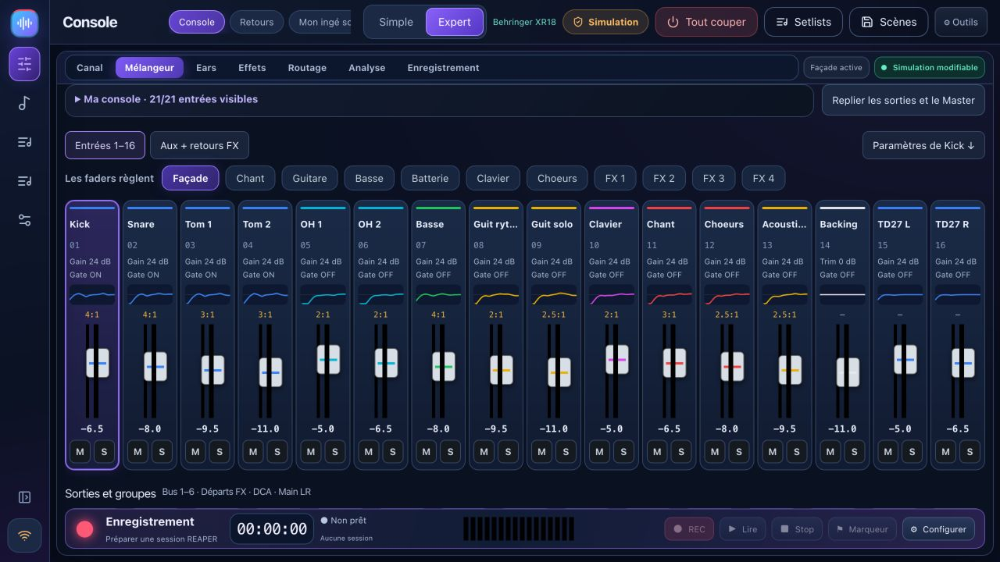

# BandPilot – bebilderte Anleitung

Desktop: **2.3.3 stabil** (Windows, macOS, Linux). Android: **2.4.0-android.1 Vorabversion**, separates APK. BandStudio: **2.3.4-dev.1 Windows-Vorabversion**, zum Testen mit der passenden BandStudio-Version; nicht Teil der stabilen Ausgabe.

Die Screenshots aus 2.2.4 zeigen eine frühere Version in der Simulation. Spätere Änderungen stehen in den Versionshinweisen. [2.3.3](RELEASE_NOTES.md) · [Android (FR)](ANDROID.md)

[Français](USER_GUIDE_FR.md) · [Soundcheck-Coach](TUTO_MON_INGE_SON_DE.md) · [Videotour](VIDEO_TOUR.md) · [Detaillierte Kompatibilität](multi-model.md)

BandPilot ist der neue Name von XR18 Studio. Es vereint Mischpultsteuerung, geführte Soundchecks, persönliche Monitore, Showvorbereitung und REAPER-Proben. Diese neuen Screenshots zeigen **Simulationen**, keine echten Audiomessungen.

[Français](USER_GUIDE_FR.md) · [English](USER_GUIDE_EN.md) · [Italiano](USER_GUIDE_IT.md) · [Español](USER_GUIDE_ES.md) · [Deutsch](USER_GUIDE_DE.md)

## Wählen Sie Ihre Sprache

Öffnen Sie **Einstellungen → Optionen · Sprache** und wählen Sie **Englisch**, **Français**, **Italiano**, **Español** oder **Deutsch**. Die Änderung erfolgt sofort, ohne Neustart oder Änderung der Audioeinstellungen. Ihre Auswahl wird auf diesem Gerät gespeichert, auch bei Desktop-Neustarts. Auf einem Telefon befindet sich die Auswahl oben auf der persönlichen Monitorseite. Song-, Szenen- und Musikernamen werden nicht übersetzt. Weitere Sprachen können auf Anfrage hinzugefügt werden.

## 1. Installieren und bewahren Sie Ihre Daten

Verwenden Sie die [offiziellen Versionen](https://herve8940.github.io/BandPilot/de.html#download): Windows `.exe`, Intel Mac `x64.dmg`, Apple Silicon Mac `arm64.dmg`, Linux `.deb` oder `.AppImage`. Schließen Sie die alte App vor der Installation. Ältere XR18 Studio-Datenkennungen bleiben erhalten; Exportieren Sie wichtige Szenen vor dem Aktualisieren. Bestehende REAPER-Projekte werden nicht automatisch konvertiert.

Installateure sind möglicherweise nicht signiert oder nicht notariell beglaubigt. Wenn das Betriebssystem eine App blockiert, überprüfen Sie deren Herkunft und lesen Sie die Systemmeldung. macOS erfordert die Berechtigung für ein lokales Netzwerk. Windows benötigt möglicherweise eine Erlaubnis für Ihr entsprechendes privates Netzwerk.

## 2. Modellfunktionen

| Familie | Fähigkeiten und Status |
|---|---|
| XR18 / X18 / MR18 | 16 Mono-Kanäle + Stereo-Aux, 6 Aux-Ausgänge, 18×18 Multitrack-USB. Physische Kontrollen am XR18 durchgeführt; Andere Hardware muss noch validiert werden. |
| XR12 / MR12 | 12 Eingänge, 4 steuerbare Mikrofonvorverstärker, 2 physische Aux-Ausgänge. Stereo-USB-Stick-Recorder, keine PC-Mehrspur-USB-Schnittstelle. In der Simulation getestete Profile; Hardware-Validierung steht noch aus. |
| X32-Varianten | **Teilweise / experimentell**: 32-Kanal-Mischpult, 16 Busse, 8 DCAs, 6 Matrizen, EQ, Kerndynamik und Sends. Die vollständige Unterstützung für Vorverstärker, Routing, Effekte, Szene, Meter und USB ist weiterhin nicht verfügbar. Coach- und Monitorsteuerung am Telefon sind auf X32 nicht verfügbar. |

Interne Busse implizieren keine physischen Ausgangssockets. Lesen Sie vor dem Live-Einsatz die [Kompatibilitätsmatrix](multi-model.md). Ein erkanntes Profil stellt nicht eine Zertifizierung aller Hardwarefunktionen dar.

## 3. Simulation und Verbindung

Wählen Sie unter **Einstellungen / Einstellungen** ein simuliertes Modell aus und aktivieren Sie die Simulation. Das Simulations-Badge bleibt sichtbar und es werden keine Hardware-Mischpult-Befehle gesendet. Die Schnittstellenbezeichnungen in den Screenshots sind französisch; In dieser englischsprachigen Anleitung werden die entsprechenden Aktionen erläutert.

Für die Hardware stellen Sie Computer und Mischpult in dasselbe lokale Netzwerk und verwenden Sie die automatische Erkennung. Die zurückgegebene Identität bestimmt Marke, Modell und Port. Wählen Sie, wann mehrere Geräte reagieren. Verbindungen beginnen schreibgeschützt. Bei der manuellen IP-Eingabe werden beide Protokollports geprüft.

Beginnen Sie mit **Mischpult → PC**, um den aktuellen Mischpult-Status auszulesen und zu speichern. **PC → Mischpult** ändert reale Einstellungen: Überprüfen Sie die Vorschau und das Modell, verringern Sie die Ausgabepegel und aktivieren Sie die Steuerung explizit. Lassen Sie die Phantomspeisung unverändert, es sei denn, sie ist erforderlich und wird separat bestätigt.

## 4. Haupträume

**Spielen** enthält Mischpult, Monitore und **Mein Tontechniker**. **Proben** arbeitet mit REAPER. **Live** folgt dem vorbereiteten Konzertprojekt. **Vorbereiten** enthält Songs, Setlists, Proben und Szenen. **Einstellungen** enthält Verbindung, Konten und Integrationen. Klappe die Seitenleiste ein, um dem Mischpult mehr Platz zu geben. Auf kleineren Bildschirmen erreichst du weitere Bedienelemente über Kanalbänke und Scrollen.

## 5. Geführter Soundcheck

Verwenden Sie das [Sechs-Schritte-Coach-Tutorial](TUTO_MON_INGE_SON_DE.md): Anschließen, Eingänge beschreiben, Verstärkung messen, Fehler beheben, Monitore vorbereiten und speichern.

Der Coach liest Einstellungen und verfügbare Messungen, nicht Ihren Audiostream. Messen Sie jeden Musiker bei seinem lautesten erwarteten Pegel. Überprüfen Sie Vorschläge und hören Sie zu, bevor Sie sie annehmen. Für die echte Verstärkungsmessung ist Hardware erforderlich. Die optionale vernetzte KI benötigt Ihren eigenen Schlüssel und Internet; Der lokale Berater bleibt auch ohne ihn verfügbar.

## 6. Einfache und Expertenkonsole

Simple bietet Haupt-/Monitorauswahl, Lautstärke, Stummschaltung und Solo. Klicken Sie auf einen Quellennamen, um detaillierte Einstellungen anzuzeigen. Namen gehören zum Mischpult oder Simulator; Beim Vorbereiten des Coach-Profils wird die Hardware nicht stillschweigend umbenannt.

Expert bietet Mischpult- und Kanalansichten mit Vorverstärker, Gate, Kompressor, EQ, Sends und Ausgang. Banken stellen Busse, Aux, FX und DCAs zur Verfügung, wie sie vom Modell unterstützt werden. Simulationseinstellungen sind Trainingsdaten, keine akustischen Ergebnisse.

**Nur In-Ears** schaltet den Hauptlautsprecher stumm und sperrt ihn; Wenn Sie diesen Modus verlassen, wird die Stummschaltung nicht automatisch aufgehoben. Geführte Änderungen und die Vorbereitung leerer Szenen nutzen Vorschauen und Backups. Direktfader wirken sofort, wenn die Steuerung aktiviert wird.

## 7. Persönliche Monitorsteuerung am Telefon

Bereiten Sie Pre-Fader-Busse vor und wählen Sie die auf Ihrem Mischpult verfügbaren physischen Ausgänge aus. Erstellen Sie jeden Musiker mit seinem Bus, starten Sie die lokale Freigabe und lassen Sie ihn seinen persönlichen QR-Code im selben Netzwerk scannen. Der Link gewährt die Kontrolle über ihren Bus: Veröffentlichen Sie ihn nicht. Die Level sind begrenzt und steigen progressiv an; Halten Sie den Hörpegel immer noch auf einem vernünftigen Niveau.

Bereits geöffnete Telefone folgen schreibgeschützten/kontrollierten Änderungen ohne Neuladen. Profile speichern Monitormischungen. Durch die Neugenerierung eines Links wird der alte Link widerrufen. Hören Sie auf zu teilen, wenn es nicht verwendet wird. X32-Monitorsteuerung am Telefon werden in dieser Version nicht unterstützt.

<h2 id="reaper">8. REAPER-Proben und Aufnahme</h2>

REAPER ist eine separate Software mit eigener Installation und Lizenz. Installieren Sie Bridge **1.5.0** von Rehearse, speichern Sie Projekte und starten Sie dann REAPER neu, um die aktualisierte Bridge zu laden. Aus Kompatibilitätsgründen bleiben die alten technischen Pfade erhalten.

1. Aktualisieren Sie unter „Aufzeichnung“ die Konsole, wählen Sie Titel und Ziel aus, erstellen und öffnen Sie dann eine Sitzung. Bestehende Sitzungen werden nicht überschrieben. Überprüfen Sie das Audiogerät, die Eingangskanäle und die Abtastrate in REAPER.
2. Die automatische Multitrack-Vorbereitung gilt für XR18/MR18/X18. Beim XR12/MR12 fehlt diese PC-Schnittstelle. Die X32-Karten-/Routing-Vorbereitung ist nicht verfügbar.
3. Öffnen Sie ein vorbereitetes ReaCue-Projekt für **Mit meinen Songs** oder verwenden Sie **Nur Band**. Songs, Abschnitte, Tracks und Takes stammen aus dem geöffneten Projekt. Konzertmetadaten verwenden das zugehörige `.concert.lua`; Wenn Sie nur `.rpp` kopieren, wird es nicht neu erstellt.
4. Präsenz spiegelt aktivierte REC-Spuren wider. Wenn Sie einen Musiker auswählen, wird dessen Aufnahmespur vorbereitet und der entsprechende Stem stummgeschaltet. Überprüfen Sie den tatsächlichen Aktivierungs- und Stummschaltungsstatus, insbesondere nach dem Wechseln der Projektregisterkarten.
5. Die Aufnahme beginnt beim ausgewählten Song. Stop speichert den Take; Markierungen bleiben während der Aufnahme verfügbar. Take-, Loop-, Präsenz- und Navigationsänderungen werden während der Aufnahme blockiert.
6. Wählen Sie eine verfügbare Aufnahme im Zeitbereich; Leere Slots werden ignoriert. **Original ReaCue** schaltet REC-Spuren stumm und öffnet Stems; Wenn Sie es verlassen, werden die vorherigen Stummschaltungszustände wiederhergestellt.
7. Platzieren Sie den Cursor innerhalb eines Abschnitts, um ihn in einer Schleife zu durchlaufen. Grenzen und Wiederholungen werden zurückgelesen. Außerhalb der Abschnitte bleibt eine Stop-Loop-Taste verfügbar.

**Die Mischpult-Simulation simuliert nicht REAPER: Record erfasst echte Audioeingänge.** Bridge-Tests ersetzen keine echten Wiedergabe- und Hörprüfungen. Halten Sie Medien bereit und verwenden Sie ein kopiertes Projekt mit seinen Medien für Experimente.

## 9. Szenen, Notizen und Setlists

Ein Lied braucht einen Titel. Fügen Sie Songs zur aktiven Setlist hinzu und speichern Sie eine benannte Setlist. Notizen und die aktive Setlist werden in der Anwendungsdatenbank gespeichert, auch wenn sich der lokale Port ändert. Warten Sie vor dem Schließen auf den Status „Gespeicherter Entwurf“. Benannte Proben bleiben separate Aufzeichnungen.

Erfassen Sie Szenen und importieren/exportieren Sie JSON. Rückrufe führen ein Backup durch und erfordern eine gültige Vorschau; Der geführte Rückruf schließt Phantomspeisung standardmäßig aus. Modellübergreifende Szenen werden nicht automatisch konvertiert. Der native `.scn`-Rückruf ist ein separater experimenteller Pfad mit FX-Limits und zusätzlichen Bestätigungen. Vollständige X32-Szenen sind nicht verfügbar.

## 10. Analyse, Shows, Konten und Fehlerbehebung

Die X-Air-Analyse nutzt verfügbare Hardwarepegel, Spektrum- und Dynamikmessungen; Überprüfen Sie A/B-Vorschläge, bevor Sie sich bewerben. Das X32-Spektrum ist nicht verfügbar. Bereiten Sie Show-Setlists, Regionen, Medien und ReaCue-Zuordnungen vor dem Live-Einsatz vor; Ein komplettes Konzert wurde in der letzten manuellen Sitzung nicht validiert.

Optionale Konten trennen Administrator, zugewiesenen Busmusiker und schreibgeschützten Gastzugriff. Keine Reaktion des Mischpults: Überprüfen Sie die Netzwerk-, IP- und lokalen Netzwerk-/Firewall-Berechtigungen. Telefon nicht verfügbar: Überprüfen Sie die Freigabe, das WLAN und den QR-Link. Bridge nicht verfügbar: Installieren Sie die aktuelle Version und starten Sie REAPER nach dem Speichern neu. Sichern Sie Szenen und Projektmedien vor dem Aktualisieren. Die Diagnose umfasst lokale IPs: Überprüfen Sie diese, bevor Sie sie öffentlich veröffentlichen.

[Versionshinweise](RELEASE_NOTES.md) · [Manuelle Korrekturen](corrections-tests-manuels.md) · [Kompatibilität](multi-model.md) · [Detaillierte X-Air-Steuerung](GUIDE_CONSOLE.md)

## BandPilot 2.3.1

**Beim letzten guten Soundcheck anknüpfen.** Verknüpfe eine vollständige Szene und Notizen mit jeder Band und prüfe die Änderungen vor dem Abruf. Musiker können Bus und Signal am Handy prüfen und ihren letzten Mix abrufen. Die Klangwerkstatt ergänzt einen A/B-Vergleich für Kick und Bass. Die Diagnose unterscheidet Netzwerk, Steuerung und REAPER-Bridge.

[Versionshinweise](RELEASE_NOTES.md)

### Technischer Bühnenplan

Musikerkarten, Eingangsliste und druckbarer Bühnenplan nutzen die Eingangs- und Monitorzuweisungen der Band.

## Instrumentenprüfung und Hilfe (2.3.2–2.3.3)

Das Speichern einer Band bereitet ihr Profil vor; geführte Audioänderungen benötigen Vorschau und Bestätigung. Bei einem Fehler lies die Meldung, schließe den Dialog und bereite einen neuen Vorschlag vor. Unterbrochene Änderungen behalten eine Sicherung zum geführten Rückgängigmachen. Miss den Gain nach einem Instrumentenwechsel neu. Die Effektwiederherstellung liest das Mischpult und überträgt die Zuordnung nur bei passenden Modellen, Effekten und Einstellungen; Archivieren einer Zuordnung ändert das Mischpult nicht.

Der Zugang zum Technical Rider öffnet Musikerkarten und den druckbaren Bühnenplan. Berichte lassen sich prüfen, lokal speichern oder ausdrücklich auf GitHub veröffentlichen; Issues sind öffentlich. Die Updateprüfung beim Start bietet einen Download an, ohne die Installation zu erzwingen. Externe Anfragen sind auf der Datenschutzseite beschrieben.

## BandPilot unterstützen

Freiwillige Unterstützung schafft Zeit für Fehlerbehebungen, Mischpulttests und Anleitungen in fünf Sprachen. Erfahrungsberichte, Übersetzungen und das Weiterempfehlen des Projekts helfen ebenfalls.

[So kannst du helfen](SUPPORT_DE.md) · [Daten und Datenschutz (FR / EN)](PRIVACY.md)
