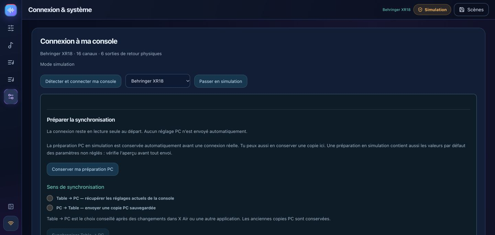
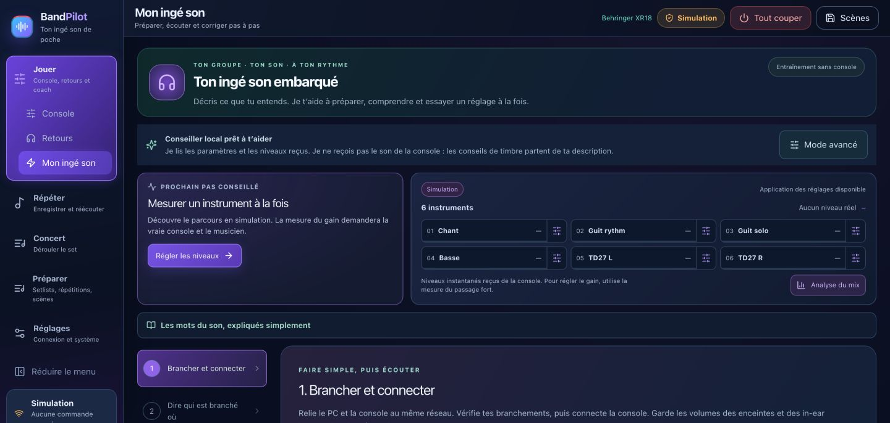
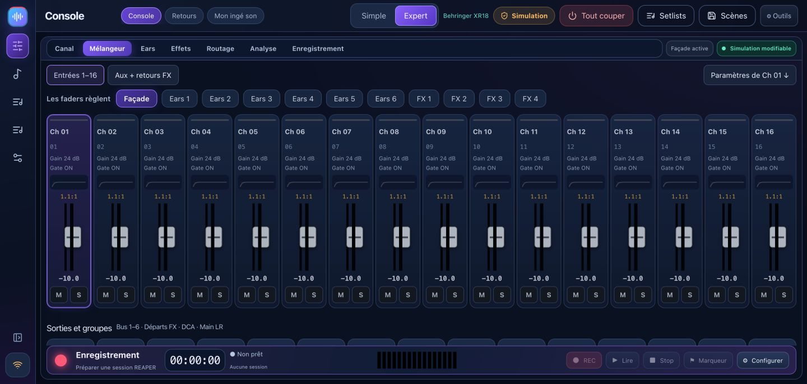
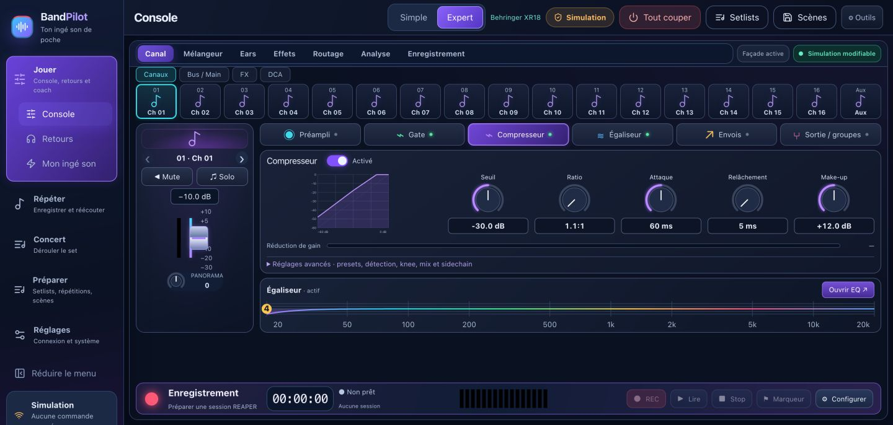
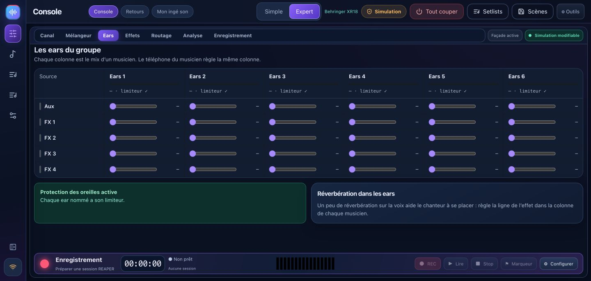
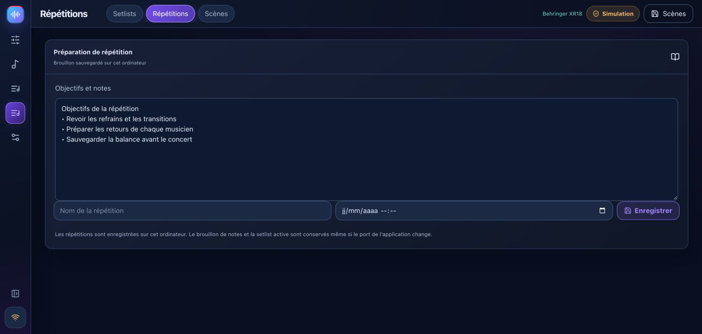

# BandPilot 2.2 — illustrated guide

**New in 2.2.2:** [personal layouts, monitor desk and REAPER fix](WORKSPACES.md#english).

[Français](USER_GUIDE_FR.md) · [Sound-check coach](TUTO_MON_INGE_SON_EN.md) · [Video tour](VIDEO_TOUR.md) · [Detailed compatibility](multi-model.md)

BandPilot is the new name of XR18 Studio. It brings together mixer control, guided sound checks, personal monitors, show preparation and REAPER rehearsals. These new screenshots show **simulation**, not real audio measurements.

[Français](USER_GUIDE_FR.md) · [English](USER_GUIDE_EN.md) · [Italiano](USER_GUIDE_IT.md) · [Español](USER_GUIDE_ES.md) · [Deutsch](USER_GUIDE_DE.md)

## Choose your language

Open **Settings → Options · Language** and select **English**, **Français**, **Italiano**, **Español** or **Deutsch**. The change is immediate, without restarting or changing audio settings. Your choice is saved on this device, including across desktop restarts. On a phone, the selector is at the top of the personal monitor page. Song, scene and musician names are not translated. More languages can be added on request.

## 1. Install and preserve your data

Use the [official releases](https://github.com/herve8940/BandPilot/releases/latest): Windows `.exe`, Intel Mac `x64.dmg`, Apple Silicon Mac `arm64.dmg`, Linux `.deb` or `.AppImage`. Close the old app before installing. Legacy XR18 Studio data identifiers are retained; export important scenes before updating. Existing REAPER projects are not automatically converted.

Installers may be unsigned or unnotarized. If the OS blocks an app, verify its origin and read the system message. macOS requires Local Network permission; Windows may require permission on your appropriate private network.

## 2. Model capabilities

| Family | Capabilities and status |
|---|---|
| XR18 / X18 / MR18 | 16 mono strips + stereo Aux, 6 Aux outputs, 18×18 multitrack USB. Physical checks performed on XR18; other hardware still needs validation. |
| XR12 / MR12 | 12 inputs, 4 controllable mic preamps, 2 physical Aux outputs. Stereo USB-stick recorder, no PC multitrack USB interface. Profiles tested in simulation; hardware validation pending. |
| X32 variants | **Partial / experimental**: 32-channel mixer, 16 buses, 8 DCAs, 6 matrices, EQ, core dynamics and sends. Full preamp, routing, FX, scene, meter and USB support remains unavailable. Coach and phone monitors are unavailable on X32. |

Internal buses do not imply physical output sockets. Read the [compatibility matrix](multi-model.md) before live use. A detected profile is not certification of every hardware feature.

## 3. Simulation and connection

In **Réglages / Settings**, choose a simulated model and activate simulation. The Simulation badge stays visible and no hardware mixer commands are sent. Interface labels in the screenshots are French; this English guide explains the corresponding actions.

For hardware, put computer and mixer on the same local network and use automatic discovery. The returned identity determines brand, model and port. Choose when several devices respond. Connections start read-only. Manual IP entry probes both protocol ports.

Start with **Mixer → PC** to read and save the existing mixer state. **PC → Mixer** changes real settings: review the preview and model, lower output levels and enable control explicitly. Leave phantom power unchanged unless needed and separately confirmed.

## 4. Main spaces

**Jouer / Play** contains Console, Monitors and Sound-check coach. **Répéter / Rehearse** works with REAPER. **Concert** follows the prepared show project. **Préparer / Prepare** contains songs, setlists, rehearsals and scenes. **Réglages / Settings** contains connection, accounts and integrations. Collapse the sidebar to give the console more room. Smaller screens use banks and scrolling for remaining controls.

## 5. Guided sound check

Use the [six-step coach tutorial](TUTO_MON_INGE_SON_EN.md): connect, describe inputs, measure gain, troubleshoot, prepare monitors and save.

The coach reads settings and available measurements, not your audio stream. Measure each musician at their loudest expected level. Review suggestions and listen before accepting. Real gain measurement requires hardware. Optional connected AI needs your own key and internet; the local advisor remains available without it.

## 6. Simple and Expert console

Simple offers main/monitor selection, volume, mute and solo. Click a source name for detailed settings. Names belong to the mixer or simulator; preparing the coach profile does not silently rename hardware.

Expert provides mixer and channel views with preamp, gate, compressor, EQ, sends and output. Banks expose buses, Aux, FX and DCAs as supported by the model. Simulation settings are training data, not acoustic results.

**Ears only** mutes and locks Main; leaving this mode does not automatically unmute it. Guided changes and blank-scene preparation use previews and backups. Direct faders act immediately when control is enabled.

## 7. Personal phone monitors

Prepare pre-fader buses and choose physical outputs available on your mixer. Create each musician with their bus, start local sharing and have them scan their personal QR code on the same network. The link grants control of their bus: do not publish it. Levels are capped and raises progressive; still keep listening levels sensible.

Already open phones follow read-only/control changes without a reload. Profiles store monitor mixes. Regenerating a link revokes the old one. Stop sharing when unused. X32 phone monitors are not supported in this release.

<h2 id="reaper">8. REAPER rehearsals and recording</h2>

REAPER is separate software with its own installation and license. Install bridge **1.2.3** from Rehearse, save projects, then restart REAPER to load the updated bridge. Legacy technical paths remain for compatibility.

1. In Recording, refresh the console, choose tracks and destination, then create and open a session. Existing sessions are not overwritten. Verify the audio device, input channels and sample rate in REAPER.
2. Automatic multitrack preparation is for XR18/MR18/X18. XR12/MR12 lack that PC interface. X32 card/routing preparation is unavailable.
3. Open a prepared ReaCue project for **With my songs**, or use **Band only**. Songs, sections, tracks and takes come from the open project. Concert metadata uses the associated `.concert.lua`; copying only `.rpp` does not recreate it.
4. Presence reflects armed REC tracks. Selecting a musician prepares their recording track and mutes the corresponding stem. Check actual arm and mute states, especially after switching project tabs.
5. Record starts at the selected song. Stop saves the take; markers remain available while recording. Take, loop, presence and navigation changes are blocked during recording.
6. Choose an available take in the time range; empty slots are ignored. **Original ReaCue** mutes REC tracks and opens stems; leaving it restores prior mute states.
7. Put the cursor inside a section to loop it. Bounds and repeat are read back. A stop-loop button remains available outside sections.

**Mixer simulation does not simulate REAPER: Record captures real audio inputs.** Bridge tests do not replace real playback and listening checks. Keep media available and use a copied project with its media for experiments.

## 9. Scenes, notes and setlists

A song needs a title. Add songs to the active setlist and save a named setlist. Notes and the active setlist are stored in the application database even when its local port changes. Wait for the saved-draft status before closing. Named rehearsals remain separate records.

Capture scenes and import/export JSON. Recalls keep a backup and require a valid preview; guided recall excludes phantom power by default. Cross-model scenes are not automatically converted. Native `.scn` recall is a separate experimental path with FX limits and additional confirmations. Complete X32 scenes are unavailable.

## 10. Analysis, shows, accounts and troubleshooting

X-Air analysis uses available hardware levels, spectrum and dynamics measurements; review A/B proposals before applying. X32 spectrum is unavailable. Prepare show setlists, regions, media and ReaCue mappings before live use; a complete concert was not validated in the last manual session.

Optional accounts separate administrator, assigned-bus musician and read-only guest access. No mixer response: check network, IP and local-network/firewall permissions. Phone unavailable: check sharing, Wi-Fi and QR link. Bridge unavailable: install the current version and restart REAPER after saving. Back up scenes and project media before updating. Diagnostics include local IPs: review them before posting publicly.

[Release notes](RELEASE_NOTES.md) · [Manual fixes](corrections-tests-manuels.md) · [Compatibility](multi-model.md) · [Detailed X-Air controls](GUIDE_CONSOLE.md)
