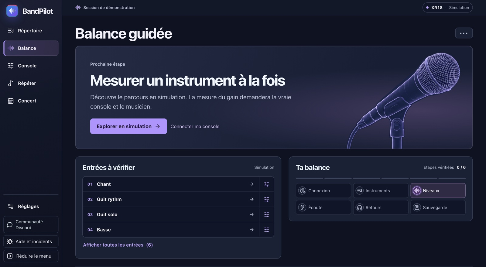
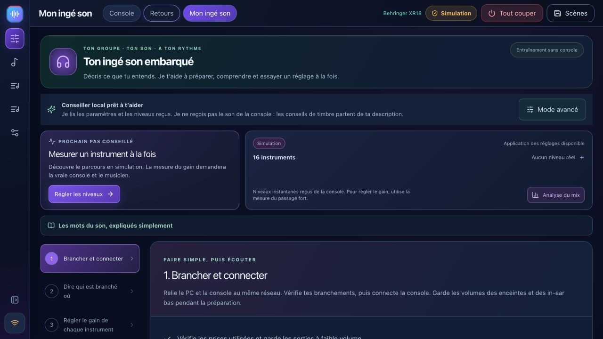
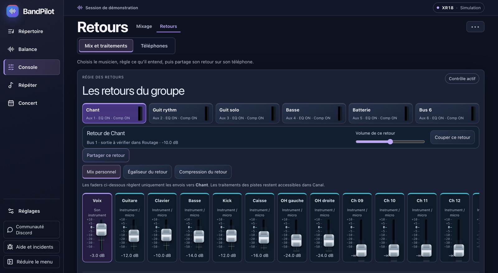

# BandPilot — illustrated guide

[Français](USER_GUIDE_FR.md) · [English](USER_GUIDE_EN.md) · [Deutsch](USER_GUIDE_DE.md) · [Español](USER_GUIDE_ES.md) · [Italiano](USER_GUIDE_IT.md)

## Your first soundcheck · BandPilot 3.0.0

On desktop you can build a soundcheck in simulation, connect your mixer and share the band’s monitor mixes over the local network.

1. Install BandPilot and open simulation mode to explore the controls.
2. Connect your computer and mixer to the same local network, then select the detected mixer.
3. Choose the instruments and check the inputs and monitor outputs before confirming the soundcheck.

Start with a blank scene or one you saved. When you confirm a fresh soundcheck with your band, unused inputs and their sends go silent. Preamp gain and phantom power stay as they are.

Assign each musician an output. Under Monitors → Phones, share the QR code for their mix on the local network. Saving the lineup updates the links without changing the audio.

Arrange songs in rehearsal. At the gig, follow the setlist and open the PDF for the current song. On desktop, the REAPER bridge connects rehearsal projects to your repertoire. REAPER is a separate download.

[Guided soundcheck tutorial](TUTO_MON_INGE_SON_EN.md) · [Release notes](RELEASE_NOTES.md#release-en) · [Detailed compatibility matrix (FR)](multi-model.md)

The illustrations in the following sections show earlier versions. Some controls have moved or have new names.

## Choose your language

Open **Settings → Options · Language** and select **English**, **Français**, **Italiano**, **Español** or **Deutsch**. The change is immediate, without restarting or changing audio settings. Your choice is saved on this device, including across desktop restarts. On a phone, the selector is at the top of the personal monitor page. Song, scene and musician names are not translated. More languages can be added on request.

## 1. Install and preserve your data

Use the [official releases](https://herve8940.github.io/BandPilot/en.html#download): Windows `.exe`, Intel Mac `x64.dmg`, Apple Silicon Mac `arm64.dmg`, Linux `.deb` or `.AppImage`. Close the old app before installing. Legacy XR18 Studio data identifiers are retained; export important scenes before updating. Existing REAPER projects are not automatically converted.

Installers may be unsigned or unnotarized. If the OS blocks an app, verify its origin and read the system message. macOS requires Local Network permission; Windows may require permission on your appropriate private network.

## 2. Model capabilities

| Family | Capabilities and status |
|---|---|
| XR18 / X18 / MR18 | 16 mono strips + stereo Aux, 6 Aux outputs, 18×18 multitrack USB. Physical checks performed on XR18; other hardware still needs validation. |
| XR12 / MR12 | 12 inputs, 4 controllable mic preamps, 2 physical Aux outputs. Stereo USB-stick recorder, no PC multitrack USB interface. Profiles tested in simulation; hardware validation pending. |
| X32 variants | **Partial / experimental**: 32-channel mixer, 16 buses, 8 DCAs, 6 matrices, EQ, core dynamics and sends. Full preamp, routing, FX, scene, meter and USB support remains unavailable. Coach and phone monitors are unavailable on X32. |

Internal buses do not imply physical output sockets. Read the [compatibility matrix](multi-model.md) before live use. A detected profile is not certification of every hardware feature.

## 3. Simulation and connection

In **Réglages / Settings**, choose a simulated model and activate simulation. The Simulation badge stays visible and no hardware mixer commands are sent. Interface labels in the screenshots are French; this English guide explains the corresponding actions.

For hardware, put computer and mixer on the same local network and use automatic discovery. The returned identity determines brand, model and port. Choose when several devices respond. Connections start read-only. Manual IP entry probes both protocol ports.

Start with **Mixer → PC** to read and save the existing mixer state. **PC → Mixer** changes real settings: review the preview and model, lower output levels and enable control explicitly. Leave phantom power unchanged unless needed and separately confirmed.

## 4. Main spaces

**Jouer / Play** contains Console, Monitors and Sound-check coach. **Répéter / Rehearse** works with REAPER. **Concert** follows the active setlist. **Préparer / Prepare** contains songs, setlists, rehearsals and scenes. **Réglages / Settings** contains connection, accounts and integrations. Collapse the sidebar to give the console more room. Smaller screens use banks and scrolling for remaining controls.

## 5. Guided sound check

Use the [six-step coach tutorial](TUTO_MON_INGE_SON_EN.md): connect, describe inputs, measure gain, troubleshoot, prepare monitors and save.

The coach reads settings and available measurements, not your audio stream. Measure each musician at their loudest expected level. Review suggestions and listen before accepting. Real gain measurement requires hardware. Optional connected AI needs your own key and internet; the local advisor remains available without it.

## 6. Simple and Expert console

Simple offers main/monitor selection, volume, mute and solo. Click a source name for detailed settings. Names belong to the mixer or simulator; preparing the coach profile does not silently rename hardware.

Expert provides mixer and channel views with preamp, gate, compressor, EQ, sends and output. Banks expose buses, Aux, FX and DCAs as supported by the model. Simulation settings are training data, not acoustic results.

**Ears only** mutes and locks Main; leaving this mode does not automatically unmute it. Guided changes and blank-scene preparation use previews and backups. Direct faders act immediately when control is enabled.

## 7. Personal phone monitors

Prepare pre-fader buses and choose physical outputs available on your mixer. Create each musician with their bus, start local sharing and have them scan their personal QR code on the same network. The link grants control of their bus: do not publish it. Levels are capped and raises progressive; still keep listening levels sensible.

Already open phones follow read-only/control changes without a reload. Profiles store monitor mixes. Regenerating a link revokes the old one. Stop sharing when unused. X32 phone monitors are not supported in this release.

<h2 id="reaper">8. REAPER rehearsals and recording</h2>

1. **Prepare REAPER** — If Rehearse prompts you, install the bridge bundled with BandPilot and restart REAPER. Open one project per tab with its media. In Rehearse → With my songs, select the project and check its inputs, armed tracks, Original track and ending. REC creates a separate take in that project; verify real audio inputs before trying it.

2. **Assign the manager** — In Monitors → Phones, create each musician’s monitor link and assign the rehearsal manager on their card. On the same local network, their QR opens My monitor, My song and Rehearse. The role can be revoked. The manager chooses a song, original, backing or take, the full song or a section, and available loop/count-in options.

3. **Read chords and lyrics** — Open My song on a phone and select Chords, Lyrics or Both. The sheet follows the REAPER project and playback position. Full screen and keeping the screen awake are optional. If a BandStudio source sheet is offered, the manager checks its timing before sharing it; Return to exported sheet reverses this choice. Missing sheets are not generated automatically.

[2.3.15 tutorial](NEW_2_3_15_EN.md)

## 9. Scenes, notes and setlists

**2.3.15 — [2.3.15 tutorial](NEW_2_3_15_EN.md)**

The library separates complete scenes, presets, soundcheck sheets and automatic backups. JSON import/export, supported X-Air .scn recall and destination slot selection for FX presets are included.

Saving or importing does not change the sound. Recall requires a preview and confirmation, with a backup first. Channel presets leave gain, phantom power, levels, monitor sends and routing unchanged.

Selective input, output and FX recall, protection by parameter family, preview and backup. Explicit preset and portable scene conversion within the supported X-Air/M-Air scope. [2.3.15 tutorial](NEW_2_3_15_EN.md)

A song needs a title. Add songs to the active setlist and save a named setlist. Notes and the active setlist are stored in the application database even when its local port changes. Wait for the saved-draft status before closing. Named rehearsals remain separate records.

Capture scenes and import/export JSON. Recalls keep a backup and require a valid preview; guided recall excludes phantom power by default. Cross-model scenes are not automatically converted. Supported native `.scn` files now use guided library recall, subject to the model and FX limits above. Complete X32 scenes are unavailable.

## 10. Analysis, shows, accounts and troubleshooting

X-Air analysis uses available hardware levels, spectrum and dynamics measurements; review A/B proposals before applying. X32 spectrum is unavailable.

Optional accounts separate administrator, assigned-bus musician and read-only guest access. No mixer response: check network, IP and local-network/firewall permissions. Phone unavailable: check sharing, Wi-Fi and QR link. Bridge unavailable: install the current version and restart REAPER after saving. Back up scenes and project media before updating. Diagnostics include local IPs: review them before posting publicly.

[Release notes](RELEASE_NOTES.md) · [Manual fixes](corrections-tests-manuels.md) · [Compatibility](multi-model.md) · [Detailed X-Air controls](GUIDE_CONSOLE.md)

## BandPilot 2.3.1

**Pick up from your last good soundcheck.** Link a complete scene and notes to each band, then review changes before recall. Musicians can check their assigned bus and source signal from their phone and recall their latest mix. Sound Workshop adds kick and bass A/B comparison. Connection diagnostics separate network, control and REAPER bridge issues.

[Release notes](RELEASE_NOTES.md)

### Technical rider and stage plot

Musician cards, the patch list and a printable stage plot use the band’s input and monitor assignments.

## Instrument validation and assistance (2.3.2–2.3.3)

Saving a band prepares its profile; guided audio changes require a preview and confirmation. If validation fails, read the error, close the dialog and prepare a new proposal. Interrupted changes retain a guided undo backup. Remeasure gain after replacing an instrument. Source ambience recovery reads the connected mixer and transfers tracking only when model, effect and settings match; archiving old tracking leaves the mixer settings in place.

The technical rider shortcut opens musician cards and the printable stage plot. Desktop debug reports can be previewed, saved locally or explicitly published to GitHub; issues are public. Update checks run at startup when internet is available and offer a download without forcing installation. See the data and privacy page for external requests.

## Support BandPilot

Voluntary support helps make time for fixes, mixer testing and guides in five languages. Field reports, translations and sharing the project also help.

[Ways to help the project](SUPPORT_EN.md) · [Data and privacy (FR / EN)](PRIVACY.md)

## Playing a concert

Open your projects in REAPER. In **Rehearse**, choose **Prepare setlist**. Add the songs you need. Arrange them and any encores in **Setlists**, then choose **Open concert**. Next advances the running order. Start a backing track, original or take separately. An attached song PDF is available on stage.
