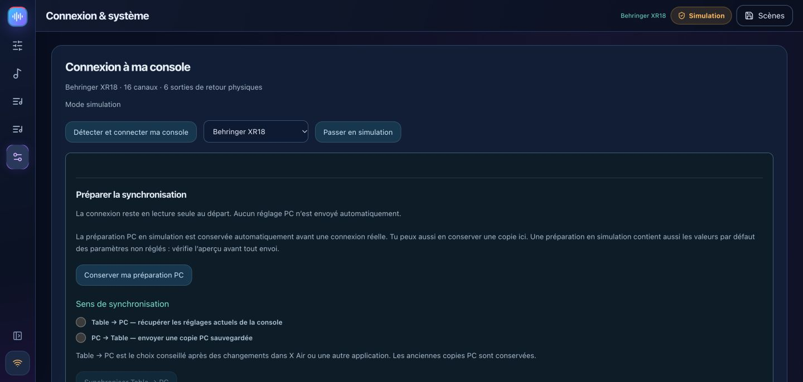
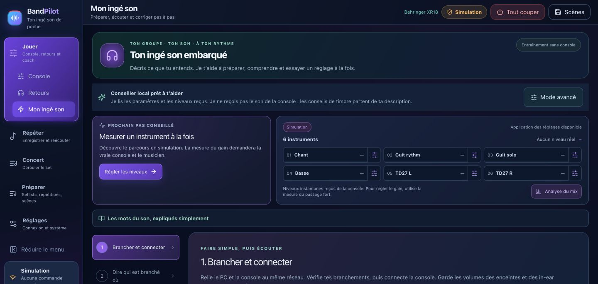
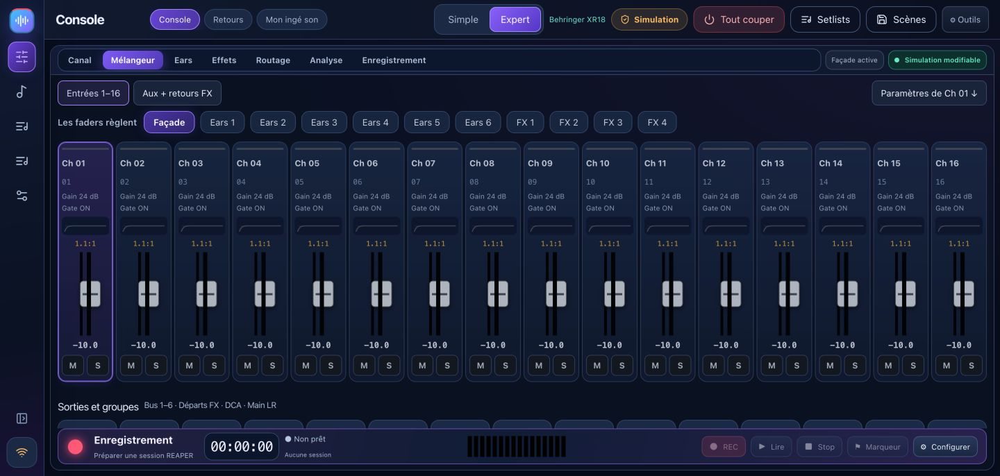
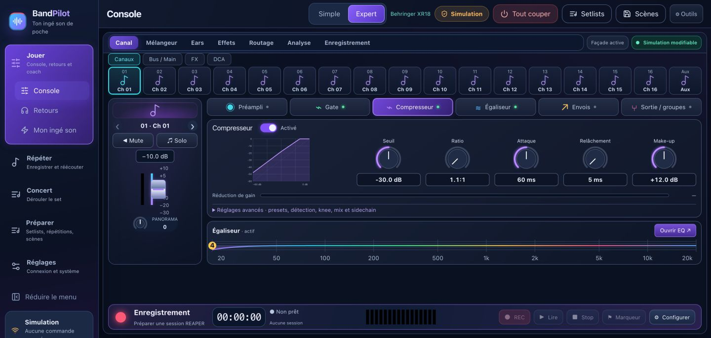
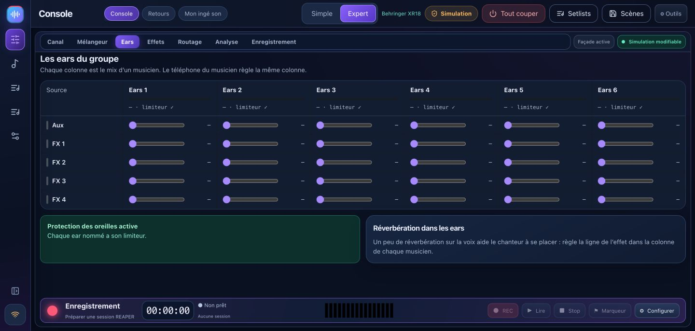
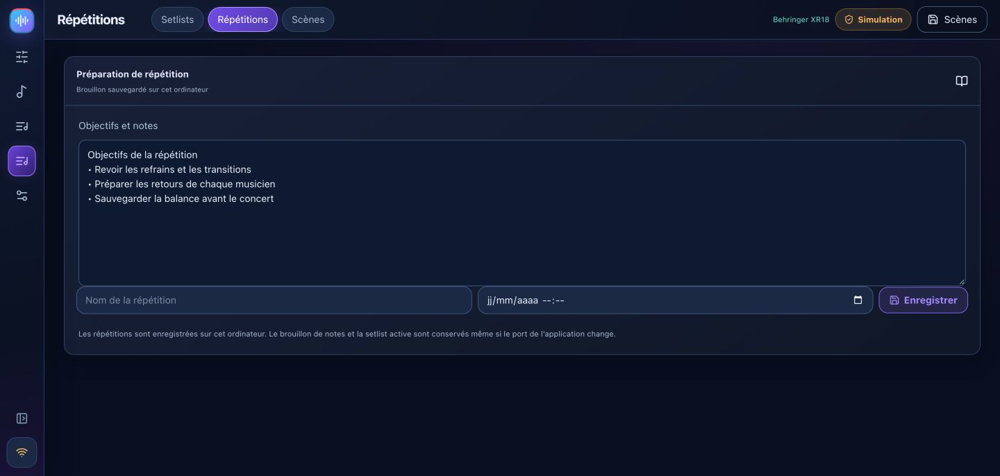

# BandPilot 2.2 — guía ilustrada

**Nuevo en 2.2.2:** [diseños personales, escritorio de monitor y corrección de REAPER](WORKSPACES.md#english).

[Français](USER_GUIDE_FR.md) · [Preparador de prueba de sonido](TUTO_MON_INGE_SON_ES.md) · [Recorrido en vídeo](VIDEO_TOUR.md) · [Compatibilidad detallada](multi-model.md)

BandPilot es el nuevo nombre de XR18 Studio. Reúne control de la mesa de mezclas, pruebas de sonido guiadas, monitores personales, preparación de espectáculos y ensayos de REAPER. Estas nuevas capturas de pantalla muestran **simulación**, no mediciones de audio reales.

[Français](USER_GUIDE_FR.md) · [English](USER_GUIDE_EN.md) · [Italiano](USER_GUIDE_IT.md) · [Español](USER_GUIDE_ES.md) · [Deutsch](USER_GUIDE_DE.md)

## Elige tu idioma

Abra **Configuración → Opciones · Idioma** y seleccione **English**, **Français**, **Italiano**, **Español** o **Deutsch**. El cambio es inmediato, sin reiniciar ni cambiar la configuración de audio. Su elección se guarda en este dispositivo, incluso cuando se reinicia el escritorio. En un teléfono, el selector se encuentra en la parte superior de la página del monitor personal. Los nombres de canciones, escenas y músicos no están traducidos. Se pueden agregar más idiomas a pedido.

## 1. Instale y conserve sus datos

Utilice las [versiones oficiales](https://github.com/herve8940/BandPilot/releases/latest): Windows `.exe`, Intel Mac `x64.dmg`, Apple Silicon Mac `arm64.dmg`, Linux `.deb` o `.AppImage`. Cierre la aplicación anterior antes de instalarla. Se conservan los identificadores de datos de Legacy XR18 Studio; exporte escenas importantes antes de actualizar. Los proyectos REAPER existentes no se convierten automáticamente.

Los instaladores pueden no estar firmados ni notariados. Si el sistema operativo bloquea una aplicación, verifique su origen y lea el mensaje del sistema. macOS requiere permiso de red local; Es posible que Windows requiera permiso en su red privada adecuada.

## 2. Capacidades del modelo

| Familia | Capacidades y estatus |
|---|---|
| XR18 / X18 / MR18 | 16 tiras mono + Aux estéreo, 6 salidas Aux, USB multipista 18×18. Comprobaciones físicas realizadas en XR18; el resto del hardware aún necesita validación. |
| XR12 / MR12 | 12 entradas, 4 preamplificadores de micrófono controlables, 2 salidas auxiliares físicas. Grabador estéreo USB, sin interfaz USB multipista para PC. Perfiles probados en simulación; validación de hardware pendiente. |
| Variantes X32 | **Parcial/experimental**: Mesa de mezclas de 32 canales, 16 buses, 8 DCA, 6 matrices, EQ, núcleo dinámico y envíos. La compatibilidad total con preamplificador, enrutamiento, efectos, escenas, medidores y USB sigue sin estar disponible. Los monitores de teléfono y entrenador no están disponibles en X32. |

Los buses internos no implican enchufes de salida físicos. Lea la [matriz de compatibilidad](multi-model.md) antes del uso en vivo. Un perfil detectado no constituye una certificación de todas las funciones del hardware.

## 3. Simulación y conexión

En **Réglages / Settings**, elija un modelo simulado y active la simulación. La insignia de simulación permanece visible y no se envían comandos de la mesa de mezclas de hardware. Las etiquetas de la interfaz en las capturas de pantalla son francesas; Esta guía en inglés explica las acciones correspondientes.

Para el hardware, coloque la computadora y la mesa de mezclas en la misma red local y use el descubrimiento automático. La identidad devuelta determina la marca, el modelo y el puerto. Elija cuándo responden varios dispositivos. Las conexiones comienzan como de solo lectura. La entrada manual de IP sondea ambos puertos de protocolo.

Comience con **Mesa de mezclas → PC** para leer y guardar el estado de la mesa de mezclas existente. **PC → Mesa de mezclas** cambia la configuración real: revise la vista previa y el modelo, reduzca los niveles de salida y habilite el control explícitamente. Deje la alimentación fantasma sin cambios a menos que sea necesario y se confirme por separado.

## 4. Espacios principales

**Tocar** reúne la consola, los monitores y **Mi ingeniero de sonido**. **Ensayar** funciona con REAPER. **Concierto** sigue el proyecto preparado para el directo. **Preparar** contiene canciones, repertorios, ensayos y escenas. **Ajustes** contiene la conexión, las cuentas y las integraciones. Reduce el menú lateral para dejar más espacio a la mesa. En pantallas pequeñas, usa los bancos y el desplazamiento para acceder a todos los controles.

## 5. Prueba de sonido guiada

Utilice el [tutorial de entrenador de seis pasos](TUTO_MON_INGE_SON_ES.md): conecte, describa entradas, mida la ganancia, solucione problemas, prepare monitores y guarde.

El entrenador lee la configuración y las mediciones disponibles, no su transmisión de audio. Mida a cada músico en su nivel más alto esperado. Revisa sugerencias y escucha antes de aceptar. La medición de ganancia real requiere hardware. La IA conectada opcional necesita su propia clave e Internet; el asesor local permanece disponible sin él.

## 6. Consola simple y experta

Simple ofrece selección principal/monitor, volumen, silencio y solo. Haga clic en el nombre de una fuente para obtener configuraciones detalladas. Los nombres pertenecen al mesa de mezclas o simulador; La preparación del perfil de entrenador no cambia silenciosamente el nombre del hardware.

Expert proporciona vistas de mesa de mezclas y canal con preamplificador, puerta, compresor, ecualizador, envíos y salida. Los bancos exponen buses, Aux, FX y DCA según lo respalda el modelo. Los ajustes de simulación son datos de entrenamiento, no resultados acústicos.

**Solo in-ear** silencia y bloquea principal; salir de este modo no lo activa automáticamente. Los cambios guiados y la preparación de escenas en blanco utilizan vistas previas y copias de seguridad. Los atenuadores directos actúan inmediatamente cuando el control está habilitado.

## 7. Monitores telefónicos personales

Prepare buses pre-fader y elija las salidas físicas disponibles en su mesa de mezclas. Crea a cada músico con su bus, comienza a compartir localmente y haz que escaneen su código QR personal en la misma red. El enlace otorga el control de su bus: no lo publique. Los niveles están limitados y los aumentos son progresivos; aún así mantenga niveles de escucha razonables.

Los teléfonos ya abiertos siguen cambios de control/solo lectura sin recarga. Los perfiles almacenan mezclas de monitores. La regeneración de un enlace revoca el anterior. Deja de compartir cuando no lo uses. Los monitores de teléfono X32 no son compatibles con esta versión.

<h2 id="reaper">8. REAPER ensayos y grabación</h2>

REAPER es un software independiente con su propia instalación y licencia. Instale el puente **1.2.3** desde Ensayo, guarde los proyectos y luego reinicie REAPER para cargar el puente actualizado. Se mantienen las rutas técnicas heredadas por razones de compatibilidad.

1. En Grabación, actualice la consola, elija las pistas y el destino, luego cree y abra una sesión. Las sesiones existentes no se sobrescriben. Verifique el dispositivo de audio, los canales de entrada y la frecuencia de muestreo en REAPER.
2. La preparación multipista automática es para XR18/MR18/X18. XR12/MR12 carecen de esa interfaz de PC. La preparación de enrutamiento/tarjeta X32 no está disponible.
3. Abra un proyecto ReaCue preparado para **Con mis canciones**, o use **Solo banda**. Las canciones, secciones, pistas y tomas provienen del proyecto abierto. Los metadatos del concierto utilizan el `.concert.lua` asociado; copiar solo `.rpp` no lo recrea.
4. La presencia refleja pistas REC armadas. Al seleccionar un músico, se prepara su pista de grabación y se silencia la plica correspondiente. Verifique los estados reales de armado y silencio, especialmente después de cambiar de pestaña del proyecto.
5. La grabación comienza en la canción seleccionada. Detener guarda la toma; Los marcadores permanecen disponibles durante la grabación. Los cambios de toma, bucle, presencia y navegación se bloquean durante la grabación.
6. Elija una toma disponible en el rango de tiempo; las ranuras vacías se ignoran. **ReaCue original** silencia las pistas REC y abre las plicas; dejarlo restaura los estados de silencio anteriores.
7. Coloque el cursor dentro de una sección para realizar un bucle. Los límites y las repeticiones se vuelven a leer. Un botón de parada permanece disponible fuera de las secciones.

**La simulación de la mesa de mezclas no simula REAPER: la grabación captura entradas de audio reales.** Las pruebas de puente no reemplazan la reproducción real y las comprobaciones de escucha. Mantenga los medios disponibles y utilice un proyecto copiado con sus medios para experimentos.

## 9. Escenas, notas y setlists

Una canción necesita un título. Agregue canciones a la lista de canciones activa y guarde una lista de canciones con nombre. Las notas y la lista de configuración activa se almacenan en la base de datos de la aplicación incluso cuando cambia su puerto local. Espere el estado de borrador guardado antes de cerrar. Los ensayos nombrados siguen siendo registros separados.

Capture escenas e importe/exporte JSON. Los retiros mantienen una copia de seguridad y requieren una vista previa válida; La recuperación guiada excluye la alimentación fantasma de forma predeterminada. Las escenas entre modelos no se convierten automáticamente. La recuperación nativa de `.scn` es una ruta experimental separada con límites de FX y confirmaciones adicionales. Las escenas X32 completas no están disponibles.

## 10. Análisis, shows, cuentas y solución de problemas

El análisis X-Air utiliza niveles de hardware disponibles, mediciones de espectro y dinámica; revise las propuestas A/B antes de presentar la solicitud. El espectro X32 no está disponible. Prepare listas de canciones, regiones, medios y asignaciones de ReaCue antes de su uso en vivo; un concierto completo no fue validado en la última sesión manual.

Las cuentas opcionales separan el administrador, el músico del bus asignado y el acceso de invitado de solo lectura. No hay respuesta de la mesa de mezclas: verifique los permisos de red, IP y red local/firewall. Teléfono no disponible: verifique compartir, Wi-Fi y enlace QR. Puente no disponible: instale la versión actual y reinicie REAPER después de guardar. Haga una copia de seguridad de las escenas y los medios del proyecto antes de actualizar. Los diagnósticos incluyen IP locales: revíselas antes de publicarlas públicamente.

[Notas de la versión](RELEASE_NOTES.md) · [Correcciones manuales](corrections-tests-manuels.md) · [Compatibilidad](multi-model.md) · [Controles detallados de X-Air](GUIDE_CONSOLE.md)
