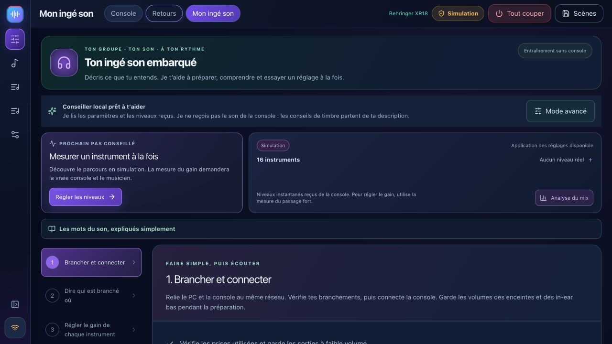
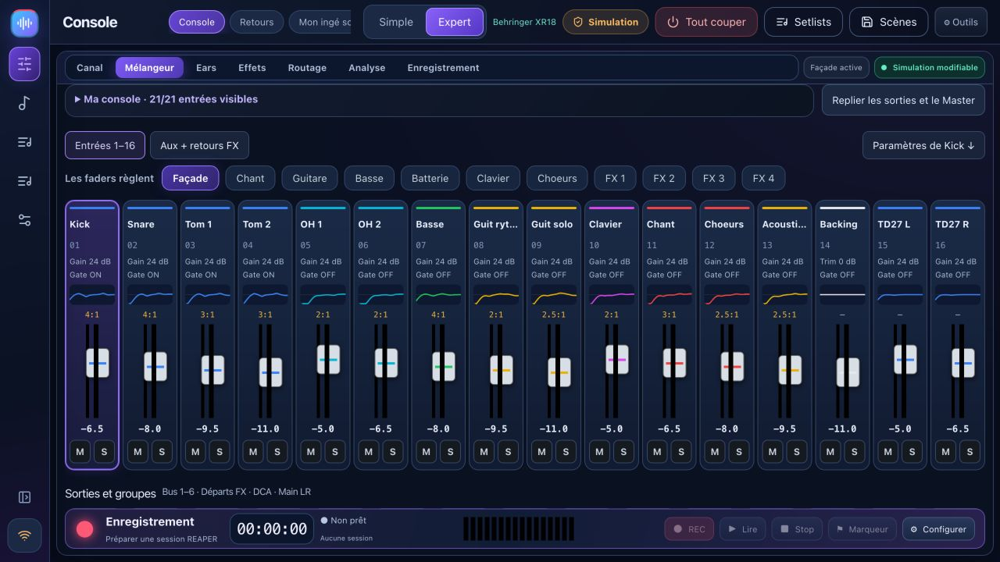
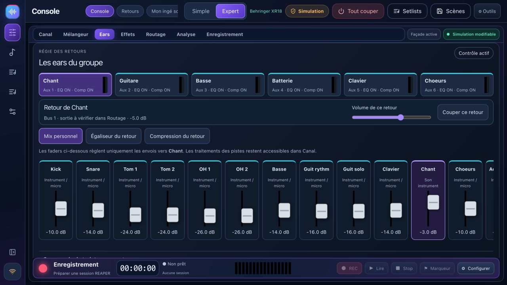

# BandPilot — guide illustré

Cette évolution concerne les applications de bureau Windows, macOS Intel/Apple Silicon et Linux. Android reste distribué séparément en 2.4.0-android.5 ; ses fonctions ne sont pas toutes celles de cette version de bureau. BandStudio est une application complémentaire indépendante.

**2.3.15 — [Tutoriel des nouveautés 2.3.15](NEW_2_3_15_FR.md)**

Les anciennes captures du guide général et la visite vidéo 2.2 restent des illustrations historiques. Ce tutoriel décrit le parcours 2.3.15.

[English](USER_GUIDE_EN.md) · [Mon ingé son](TUTO_MON_INGE_SON.md) · [Visite vidéo](VIDEO_TOUR.md) · [Compatibilité détaillée](multi-model.md)

BandPilot est le nouveau nom de XR18 Studio. Il réunit console, balance guidée, retours personnels, préparation de concert et répétitions avec REAPER. Les captures ci-dessous proviennent de la version 2.2.4 en **simulation** ; ce ne sont pas des mesures audio réelles.

[Français](USER_GUIDE_FR.md) · [English](USER_GUIDE_EN.md) · [Italiano](USER_GUIDE_IT.md) · [Español](USER_GUIDE_ES.md) · [Deutsch](USER_GUIDE_DE.md)

## Choisir la langue

Ouvre **Réglages → Options · Langue**, puis choisis **Français**, **English**, **Italiano**, **Español** ou **Deutsch**. Le changement est immédiat, sans redémarrage ni modification des réglages audio. Le choix reste mémorisé sur cet appareil, y compris après redémarrage de l’application de bureau. Sur un téléphone, le sélecteur se trouve en haut du retour personnel. Les noms de morceaux, scènes et musiciens ne sont pas traduits. D’autres langues peuvent être ajoutées suivant la demande.

## 1. Installer et conserver ses données

Télécharge la version de ton ordinateur dans [les versions officielles](https://herve8940.github.io/BandPilot/#download) : Windows `.exe`, Mac Intel `x64.dmg`, Mac Apple Silicon `arm64.dmg`, Linux `.deb` ou `.AppImage`. Ferme l’ancienne application avant d’installer. Les identifiants de données de XR18 Studio sont conservés : exporte tout de même tes scènes importantes avant la mise à jour. Aucun projet REAPER n’est converti automatiquement.

Si le système bloque le lancement, vérifie l’origine et consulte son message de sécurité. Sur macOS, l’autorisation **Réseau local** est nécessaire pour la découverte et les retours. Sur Windows, autorise l’application sur le réseau privé approprié. Les installateurs peuvent ne pas être signés ou notariés.

## 2. Vérifier les capacités du modèle

| Famille | Préparation et limites |
|---|---|
| XR18 / X18 / MR18 | 16 canaux mono + Aux stéréo, 6 sorties Aux, USB multipiste 18×18. Essais physiques réalisés sur XR18 ; validation des autres appareils restante. |
| XR12 / MR12 | 12 entrées, 4 préamplis micro pilotables, 2 Aux physiques. USB stéréo sur clé : pas d’interface multipiste PC. Profils testés en simulation, validation physique restante. |
| X32 et variantes | **Partiel et expérimental** : mélangeur 32 canaux, 16 bus, 8 DCA, 6 matrices, EQ, dynamique principale et envois. Préamplis, routage, FX, scènes complètes, vumètres et USB complets restent à adapter. Coach et retours téléphone non disponibles sur X32. |

Ne confonds pas bus internes et prises physiques. Consulte [la matrice](multi-model.md) avant un concert. La prise en charge d’un profil ne certifie pas toutes ses fonctions sur matériel.

## 3. Découvrir sans console, puis connecter

Dans **Réglages → Connexion**, choisis le modèle à simuler puis **Passer en simulation**. Le badge Simulation reste affiché. Cette préparation n’envoie pas de réglage audio à une console.

Pour le matériel, relie ordinateur et console au même réseau local puis clique **Détecter et connecter ma console**. L’identité répondue détermine marque, modèle et port ; s’il y a plusieurs appareils, choisis le bon. La connexion démarre en lecture seule. En manuel, saisis l’IP : les deux familles de ports sont sondées.

Commence par **Table → PC** pour récupérer l’état de la console et sauvegarde-le. **PC → Table** envoie réellement la préparation : lis l’aperçu, garde les sorties basses et vérifie le modèle. Le contrôle matériel exige son activation explicite. Laisse le 48 V inchangé sauf besoin précis et confirmation dédiée.

## 4. Se repérer

- **Jouer** : Console, Retours, Mon ingé son.
- **Répéter** : avec tes morceaux ou groupe seul, via REAPER.
- **Concert** : déroulement du set dans le projet préparé.
- **Préparer** : répertoire, setlists, répétitions et scènes.
- **Réglages** : connexion, comptes, diagnostic et intégrations.

Le bouton du bas réduit ou agrandit le menu. L’interface s’adapte à l’écran ; sur un petit écran, les banques et défilements donnent accès aux contrôles restants.

## 5. Faire la balance

Le [tutoriel Mon ingé son](TUTO_MON_INGE_SON.md) suit six étapes : connecter, décrire les branchements, mesurer les gains, corriger à l’écoute, préparer les retours et sauvegarder.

Le coach lit les réglages et les mesures disponibles, pas le flux audio. Fais jouer le musicien à son niveau le plus fort pour mesurer le gain. Les courbes, seuils et propositions restent à vérifier à l’oreille. Une mesure réelle demande la vraie console. L’IA connectée est facultative et demande une clé personnelle et Internet ; le conseiller local reste disponible sans elle.

## 6. Console Simple et Expert

**Simple** : sélectionne la façade ou le retour, règle volume, mute et solo. Le nom d’une source ouvre ses réglages détaillés. Les noms proviennent de la console ou du simulateur ; préparer le groupe dans le coach ne renomme pas silencieusement une console réelle.

**Expert** : Mélangeur donne les tranches et les sorties ; Canal affiche le préampli, gate, compresseur, EQ, envois et sortie. Les banques donnent accès aux bus, Aux, FX et DCA. Les fonctions proposées dépendent du modèle. Les valeurs de simulation sont des réglages d’entraînement, pas des résultats acoustiques.

**Ears seulement** coupe et verrouille le Main. Quitter ce mode ne le rallume pas automatiquement. La scène vierge et les changements guidés utilisent aperçu et sauvegarde. Les faders directs agissent dès le geste si le contrôle est actif.

## 7. Retours sur téléphone

Prépare les bus en pré-fader et choisis les sorties réellement disponibles. Dans Retours, crée le musicien et son bus. Démarre le partage local, puis fais scanner **son** QR code sur le même réseau. Le lien permet de régler son bus : ne le publie pas. Les niveaux sont plafonnés et leur montée progressive ; cela ne remplace pas un niveau d’écoute prudent.

Le téléphone suit les changements lecture seule/contrôle sans rechargement. Les profils conservent un mix de retour. Régénérer le lien révoque l’ancien. Arrête le partage lorsqu’il n’est plus nécessaire. Les retours téléphone X32 ne sont pas disponibles dans cette version.

<h2 id="reaper">8. Répéter et enregistrer avec REAPER</h2>

1. **Préparer REAPER** — Installe à nouveau le pont livré avec 2.3.15, même si son numéro affiche déjà 1.5.0, puis redémarre REAPER. Ouvre un projet par onglet avec ses médias. Dans Répéter → Avec mes morceaux, sélectionne le projet, vérifie ses entrées et pistes armées, sa piste Original et sa fin. REC crée une prise séparée dans ce projet ; vérifie les véritables entrées audio avant l’essai.

2. **Donner la main au gestionnaire** — Dans Retours → Téléphones, crée un lien de retour par musicien et désigne le gestionnaire sur sa fiche. Sur le même réseau local, son QR donne accès à Mon retour, Mon morceau et Répéter. Le rôle est révocable. Le gestionnaire choisit le morceau, l’original, l’accompagnement ou une prise, le morceau entier ou une section, la boucle et le décompte proposés.

3. **Lire les accords et paroles** — Sur le téléphone, ouvre Mon morceau et choisis Accords, Paroles ou Les deux. La fiche suit le projet et la position REAPER. Plein écran et maintien de l’écran allumé sont facultatifs. Si une fiche source BandStudio est proposée, le gestionnaire vérifie son calage avant de la partager ; Revenir à la fiche exportée annule ce choix. Une fiche absente n’est pas reconstruite automatiquement.

[Tutoriel des nouveautés 2.3.15](NEW_2_3_15_FR.md)

## 9. Scènes, notes et setlists

**2.3.15 — [Tutoriel des nouveautés 2.3.15](NEW_2_3_15_FR.md)**

La bibliothèque sépare scènes complètes, presets, fiches de balance et sauvegardes automatiques. Import/export JSON, rappel des fichiers X-Air .scn compatibles et choix du slot pour les presets FX.

Enregistrer ou importer ne modifie pas le son. Chaque rappel demande un aperçu et une confirmation, avec sauvegarde préalable. Le rappel d’un preset de canal conserve gain, 48 V, volumes, retours et routage.

Rappels sélectifs des entrées, sorties et FX, protections par famille de réglages, aperçu et sauvegarde. Conversion explicite de presets et de scènes portables au sein de X-Air/M-Air, dans le périmètre pris en charge. [Tutoriel des nouveautés 2.3.15](NEW_2_3_15_FR.md)

Dans Préparer, un titre est requis pour ajouter un morceau. Ajoute les titres à la setlist active puis sauvegarde une setlist nommée. Le brouillon de notes et la setlist active restent dans la base de l’application même si son port change. Attends l’indication **Brouillon sauvegardé sur cet ordinateur** avant de fermer ; les répétitions nommées restent des enregistrements distincts.

Les scènes complètes peuvent être capturées et exportées/importées en JSON. Le rappel fait une sauvegarde préalable et exige un aperçu valide ; le 48 V est exclu du rappel guidé par défaut. Une scène d’un autre modèle n’est pas convertie automatiquement. Les fichiers natifs `.scn` compatibles utilisent désormais le rappel guidé de la bibliothèque, avec les limites de modèles et d’effets indiquées ci-dessus. Les scènes complètes X32 sont indisponibles.

## 10. Analyse, concert, comptes et dépannage

- **Analyse X-Air** : niveaux, spectre et conseils utilisent les mesures matérielles disponibles. Vérifie les propositions A/B et annule si le résultat ne convient pas. Pas de spectre X32 dans cette version.
- **Concert / ReaCue** : prépare et vérifie setlist, régions, médias et associations avant le live. L’intégration externe dépend de son adaptateur et n’a pas été validée sur un concert complet lors des derniers essais.
- **Comptes facultatifs** : administrateur pour la configuration ; musicien limité à ses bus ; invité en consultation. L’activation change les accès : conserve tes identifiants.
- Console absente : vérifie réseau commun, IP, autorisation Réseau local et pare-feu. Téléphone inaccessible : même réseau, partage actif, bon QR. Pont indisponible : installe sa version actuelle et redémarre REAPER après sauvegarde.
- Avant mise à jour : exporte les scènes et sauvegarde les projets et leurs médias. Pour un incident, télécharge le diagnostic dans Réglages ; relis-le avant de le joindre publiquement, car il contient les IP locales.

[Notes de version](RELEASE_NOTES.md) · [Essais et corrections](corrections-tests-manuels.md) · [Limites par modèle](multi-model.md) · [Documentation détaillée des contrôles X-Air](GUIDE_CONSOLE.md)

## BandPilot 2.3.1

**Reprendre la dernière bonne balance.** Associe une scène complète et des notes à chaque groupe, puis vérifie les différences avant le rappel sur la console. Depuis son téléphone, chaque musicien peut vérifier son bus et le signal d’une source, puis rappeler son dernier mix. L’Atelier du son propose une comparaison A/B du kick et de la basse. Le diagnostic de connexion distingue réseau, contrôle et pont REAPER.

[Nouveautés](RELEASE_NOTES.md)

### Fiche technique et plan de scène

Dans **Mon ingé son → Dire qui est branché où**, ouvre **Fiche technique du groupe**. Les entrées et les musiciens sont repris de la préparation du groupe.

- **Informations** : groupe, concert, contact technique, espace scénique, matériel apporté et demandé à la salle.
- **Câblage** : ouvre une entrée pour indiquer le micro ou la DI, le pied, le fournisseur, les remarques et le besoin de 48 V (requis, non requis ou à confirmer). Chaque canal d’une paire stéréo reste visible dans le document.
- **Scène & retours** : déplace les musiciens avec la souris, au doigt ou avec les flèches du clavier. Les sélecteurs de position restent disponibles. Précise le type de retour, le besoin mono/stéréo et les prises électriques. Ces besoins ne modifient pas le routage de la console ; les sorties stéréo sont à convenir avec la salle.
- **Aperçu PDF** : consulte le document avant de l’envoyer. Il sépare le plan de scène et l’accueil du câblage et des retours. De longues notes peuvent ajouter des pages.

**Enregistrer** conserve la fiche avec le groupe. **Exporter PDF** ouvre une fenêtre d’enregistrement dans l’application Mac ; dans un navigateur, choisis l’enregistrement PDF dans la fenêtre d’impression. L’export reprend les champs affichés, même si tu n’as pas encore enregistré les dernières modifications. **Imprimer** imprime uniquement la fiche. Ces actions ne changent aucun réglage audio.

## Récupération des ambiances et assistance (2.3.2)

Dans **Mon ingé son**, les raccourcis **Fiche technique · Plan de scène · PDF** et **Ambiances des sources** donnent accès directement à ces outils. L’ajout ou le choix d’un instrument ne lit plus la console : enregistre le groupe, puis utilise **Préparer les réglages**. L’application demande toujours confirmation avant d’appliquer.

Si une ambiance reste attachée à une ancienne adresse, **Vérifier et retrouver cette ambiance** relit les réglages sur la console connectée. Le suivi est transféré seulement si le modèle, l’effet et les réglages correspondent. Cette opération ne change pas le son. **Archiver cet ancien suivi** libère le suivi dans BandPilot ; les effets restent configurés sur la console. Un slot encore alimenté par une autre source n’est pas remplacé.

Le bouton **Signaler un problème** se trouve en bas du menu. Décris le problème, prépare le rapport, puis vérifie son aperçu. Tu peux enregistrer le fichier JSON sans Internet. Pour créer une issue directement, connecte un jeton personnel GitHub limité au dépôt `herve8940/BandPilot`, permission **Issues: read and write**. Il est conservé dans le coffre chiffré du système, jamais dans le rapport. Tu peux le retirer avec **Déconnecter GitHub**. Sans cette connexion, **Créer dans le navigateur** copie le rapport : colle-le dans la description et valide l’issue sur GitHub. Les issues sont publiques.

Les rapports natifs sont conservés dans le dossier de données, sous `reports` (vingt derniers rapports). Sous macOS : `~/Library/Application Support/xr18-studio/reports`. Sous Windows : `%APPDATA%\xr18-studio\reports`. Aucune base complète, piste audio ou fiche de contacts n’est envoyée. Les descriptions libres restent à relire avant publication.

Au démarrage de l’application de bureau, une vérification discrète recherche un installateur stable publié depuis `main`. Sans Internet, le contrôle de la console reste disponible. Une bannière propose **Télécharger** si une nouvelle version compatible est publiée ; le téléchargement et l’installation ne sont jamais imposés pendant une session. Le panneau de support permet aussi une vérification manuelle et affiche la version et la fabrication.

## Validation d’un instrument (2.3.3)

Ajouter un instrument ou changer son nom prépare le groupe. « Enregistrer mon groupe » conserve cette préparation. « Préparer les réglages » enregistre le groupe puis affiche les modifications proposées ; la console ne change qu’après validation dans cette fenêtre.

Si la validation échoue, lis le message dans la fenêtre, ferme-la puis prépare une nouvelle proposition. Il n’est pas nécessaire de redémarrer BandPilot. Si une modification a été interrompue, « Annuler le dernier réglage guidé » permet de revoir et confirmer la restauration de la sauvegarde.

Après remplacement d’un instrument, refais sa mesure de gain. Changer sa prise conserve le musicien associé, mais les mesures liées à l’ancienne prise doivent être refaites.

## Soutenir BandPilot

Un soutien volontaire aide à consacrer du temps aux corrections, aux essais sur les consoles et aux guides en cinq langues. Un retour de terrain, une traduction ou un partage du projet sont aussi utiles.

[Comment aider le projet](SUPPORT_FR.md) · [Données et confidentialité (FR / EN)](PRIVACY.md)
