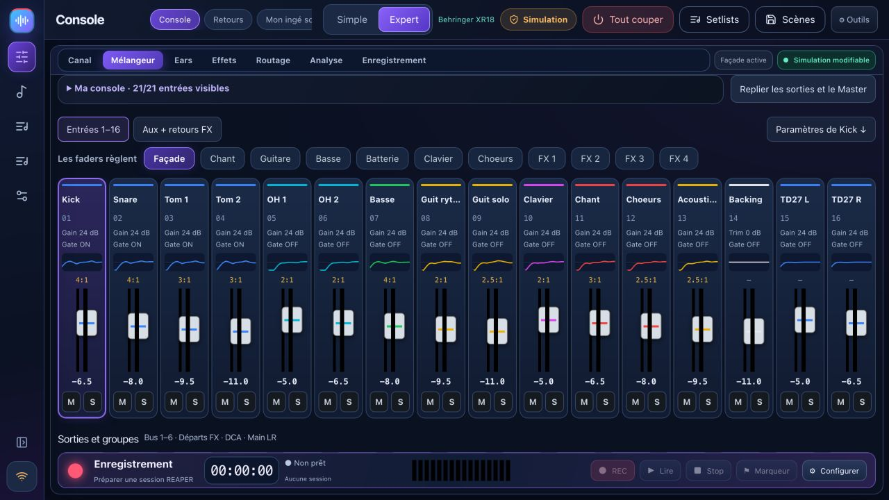

# BandPilot 2.2 — guida illustrata

**Novità nella versione 2.2.2:** [layout personali, regia monitor e correzione REAPER](WORKSPACES.md#english).

[Francese](USER_GUIDE_FR.md) · [Coach controllo audio](TUTO_MON_INGE_SON_IT.md) · [Tour video](VIDEO_TOUR.md) · [Compatibilità dettagliata](multi-model.md)

BandPilot è il nuovo nome di XR18 Studio. Riunisce il controllo del mixer, i soundcheck guidati, i monitor personali, la preparazione dello spettacolo e le prove REAPER. Questi nuovi screenshot mostrano una **simulazione**, non misurazioni audio reali.

[Français](USER_GUIDE_FR.md) · [English](USER_GUIDE_EN.md) · [Italiano](USER_GUIDE_IT.md) · [Español](USER_GUIDE_ES.md) · [Deutsch](USER_GUIDE_DE.md)

## Scegli la tua lingua

Apri **Impostazioni → Opzioni · Lingua** e seleziona **English**, **Français**, **Italiano**, **Español** o **Deutsch**. La modifica è immediata, senza riavviare o modificare le impostazioni audio. La tua scelta viene salvata su questo dispositivo, anche durante i riavvii del desktop. Su un telefono, il selettore si trova nella parte superiore della pagina del monitor personale. I nomi delle canzoni, delle scene e dei musicisti non sono tradotti. Su richiesta è possibile aggiungere altre lingue.

## 1. Installa e conserva i tuoi dati

Utilizzare le [versioni ufficiali](https://github.com/herve8940/BandPilot/releases/latest): Windows `.exe`, Intel Mac `x64.dmg`, Apple Silicon Mac `arm64.dmg`, Linux `.deb` o `.AppImage`. Chiudi la vecchia app prima dell'installazione. Gli identificatori dei dati legacy XR18 Studio vengono conservati; esportare scene importanti prima dell'aggiornamento. I progetti REAPER esistenti non vengono convertiti automaticamente.

Gli installatori potrebbero non essere firmati o non autenticati. Se il sistema operativo blocca un'app, verificane l'origine e leggi il messaggio di sistema. macOS richiede l'autorizzazione di rete locale; Windows potrebbe richiedere l'autorizzazione sulla rete privata appropriata.

## 2. Capacità del modello

| Famiglia | Capacità e status |
|---|---|
| XR18 / X18 / MR18 | 16 canali mono + Aux stereo, 6 uscite Aux, USB multitraccia 18×18. Controlli fisici eseguiti su XR18; altro hardware necessita ancora di convalida. |
| XR12/MR12 | 12 ingressi, 4 preamplificatori microfonici controllabili, 2 uscite Aux fisiche. Registratore stereo su chiavetta USB, nessuna interfaccia USB multitraccia per PC. Profili testati in simulazione; convalida hardware in sospeso. |
| Varianti X32 | **Parziale/sperimentale**: mixer a 32 canali, 16 bus, 8 DCA, 6 matrici, EQ, dinamiche di base e mandate. Il supporto completo per preamplificatore, routing, FX, scena, meter e USB non è disponibile. Il coach e i monitor sul telefono non sono disponibili su X32. |

I bus interni non implicano prese di uscita fisiche. Leggere la [matrice di compatibilità](multi-model.md) prima dell'uso dal vivo. Un profilo rilevato non è la certificazione di ogni funzionalità hardware.

## 3. Simulazione e connessione

In **Réglages / Impostazioni**, scegli un modello simulato e attiva la simulazione. Il badge Simulazione rimane visibile e non vengono inviati comandi del mixer hardware. Le etichette dell'interfaccia negli screenshot sono francesi; questa guida spiega le azioni corrispondenti.

Per l'hardware, metti computer e mixer sulla stessa rete locale e utilizza il rilevamento automatico. L'identità restituita determina marca, modello e porta. Scegli quando rispondono più dispositivi. Le connessioni iniziano in sola lettura. L'immissione manuale dell'IP sonda entrambe le porte del protocollo.

Inizia con **Mixer → PC** per leggere e salvare lo stato del mixer esistente. **PC → Mixer** modifica le impostazioni reali: rivedi l'anteprima e il modello, abbassa i livelli di output e abilita il controllo esplicitamente. Lasciare invariata l'alimentazione phantom a meno che non sia necessaria e confermata separatamente.

## 4. Spazi principali

**Suona** raccoglie console, monitor e **Il mio fonico**. **Prove** funziona con REAPER. **Concert** segue il progetto dello spettacolo preparato. **Prepara** contiene brani, scalette, prove e scene. **Impostazioni** contiene connessione, account e integrazioni. Riduci il menu laterale per lasciare più spazio al mixer. Sugli schermi piccoli, usa i banchi e lo scorrimento per raggiungere tutti i controlli.

## 5. Controllo del suono guidato

Utilizza il [tutorial in sei fasi](TUTO_MON_INGE_SON_IT.md): collega, descrivi gli ingressi, misura il guadagno, risolvi i problemi, prepara i monitor e salva.

Il coach legge le impostazioni e le misurazioni disponibili, non il tuo flusso audio. Misura ciascun musicista al livello più alto previsto. Esamina i suggerimenti e ascolta prima di accettare. La misurazione del guadagno reale richiede hardware. L'intelligenza artificiale connessa opzionale richiede la tua chiave e Internet; il consulente locale rimane disponibile senza di essa.

## 6. Console semplice ed esperta

Simple offre selezione principale/monitor, volume, mute e solo. Fare clic sul nome di una fonte per le impostazioni dettagliate. I nomi appartengono al mixer o al simulatore; la preparazione del profilo delil coach non rinomina silenziosamente l'hardware.

Expert fornisce visualizzazioni di mixer e canali con preamplificatore, gate, compressore, EQ, mandate e uscita. Le banche espongono bus, Aux, FX e DCA come supportati dal modello. Le impostazioni della simulazione sono dati di allenamento, non risultati acustici.

**Solo in-ear** disattiva e blocca l'audio Principale; l'uscita da questa modalità non ne riattiva automaticamente l'audio. Le modifiche guidate e la preparazione delle scene vuote utilizzano anteprime e backup. I fader diretti agiscono immediatamente quando il controllo è abilitato.

## 7. Monitor personali sul telefono

Prepara i bus pre-fader e scegli le uscite fisiche disponibili sul tuo mixer. Crea ogni musicista con il suo bus, avvia la condivisione locale e fagli scansionare il suo codice QR personale sulla stessa rete. Il collegamento garantisce il controllo del proprio bus: non pubblicarlo. I livelli sono limitati e gli aumenti sono progressivi; mantenere comunque i livelli di ascolto ragionevoli.

I telefoni già aperti seguono le modifiche di sola lettura/controllo senza ricaricare. I profili memorizzano i mix di monitor. La rigenerazione di un collegamento revoca quello vecchio. Interrompi la condivisione quando non viene utilizzato. I monitor dei telefoni X32 non sono supportati in questa versione.

<h2 id="reaper">8. Prove e registrazione REAPER</h2>

REAPER è un software separato con la propria installazione e licenza. Installa il bridge **1.2.3** da Rehearse, salva i progetti, quindi riavvia REAPER per caricare il bridge aggiornato. I percorsi tecnici legacy rimangono per compatibilità.

1. In Registrazione, aggiorna la console, scegli le tracce e la destinazione, quindi crea e apri una sessione. Le sessioni esistenti non vengono sovrascritte. Verifica il dispositivo audio, i canali di ingresso e la frequenza di campionamento in REAPER.
2. La preparazione multitraccia automatica è per XR18/MR18/X18. XR12/MR12 non hanno quell'interfaccia PC. La preparazione della scheda/routing X32 non è disponibile.
3. Aprire un progetto ReaCue preparato per **Con i miei brani** o utilizzare **Solo gruppo**. Canzoni, sezioni, tracce e riprese provengono dal progetto aperto. I metadati del concerto utilizzano il `.concert.lua` associato; copiare solo `.rpp` non lo ricrea.
4. La presenza riflette le tracce REC armate. Selezionando un musicista si prepara la traccia di registrazione e si disattiva l'audio del stem corrispondente. Controlla gli stati effettivi di attivazione e disattivazione dell'audio, soprattutto dopo aver cambiato scheda di progetto.
5. La registrazione inizia dal brano selezionato. Stop salva la ripresa; i marcatori rimangono disponibili durante la registrazione. Le modifiche a ripresa, loop, presenza e navigazione vengono bloccate durante la registrazione.
6. Scegli una ripresa disponibile nell'intervallo di tempo; gli slot vuoti vengono ignorati. **ReaCue originale** disattiva l'audio delle tracce REC e apre i stem; lasciandolo ripristina gli stati muti precedenti.
7. Posiziona il cursore all'interno di una sezione per eseguirne il loop. I limiti e le ripetizioni vengono riletti. Un pulsante di arresto del ciclo rimane disponibile al di fuori delle sezioni.

**La simulazione del mixer non simula REAPER: la registrazione cattura gli ingressi audio reali.** I test bridge non sostituiscono i controlli di riproduzione e ascolto reali. Mantieni i media disponibili e utilizza un progetto copiato con i relativi media per gli esperimenti.

## 9. Scene, note e scalette

Una canzone ha bisogno di un titolo. Aggiungi brani alla setlist attiva e salva una setlist con nome. Le note e la setlist attiva vengono archiviate nel database dell'applicazione anche quando cambia la porta locale. Attendi lo stato di bozza salvata prima di chiudere. Le prove con nome rimangono registrazioni separate.

Cattura scene e importa/esporta JSON. I richiami mantengono un backup e richiedono un'anteprima valida; il richiamo guidato esclude l'alimentazione phantom per impostazione predefinita. Le scene tra modelli diversi non vengono convertite automaticamente. Il richiamo nativo `.scn` è un percorso sperimentale separato con limiti FX e conferme aggiuntive. Le scene complete di X32 non sono disponibili.

## 10. Analisi, spettacoli, resoconti e risoluzione dei problemi

L'analisi X-Air utilizza i livelli hardware disponibili, le misurazioni di spettro e dinamica; esaminare le proposte A/B prima di candidarsi. Lo spettro X32 non è disponibile. Preparare setlist, regioni, media e mappature ReaCue prima dell'uso dal vivo; non è stato convalidato un concerto completo nell'ultima sessione manuale.

Gli account opzionali separano l'accesso amministratore, musicista bus assegnato e ospite di sola lettura. Nessuna risposta del mixer: controlla i permessi di rete, IP e rete locale/firewall. Telefono non disponibile: controlla condivisione, Wi-Fi e collegamento QR. Bridge non disponibile: installa la versione corrente e riavvia REAPER dopo aver salvato. Eseguire il backup delle scene e dei supporti di progetto prima dell'aggiornamento. La diagnostica include gli IP locali: esaminali prima di pubblicarli pubblicamente.

[Note sulla versione](RELEASE_NOTES.md) · [Correzioni manuali](corrections-tests-manuels.md) · [Compatibilità](multi-model.md) · [Controlli X-Air dettagliati](GUIDE_CONSOLE.md)
