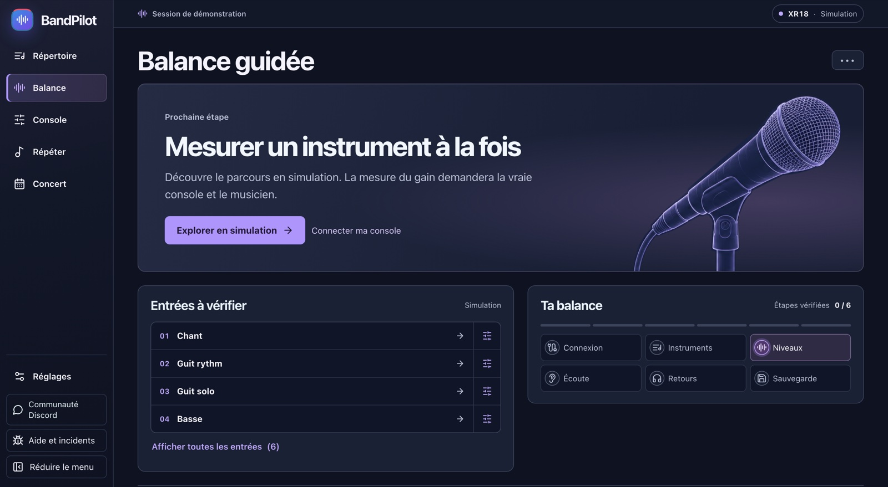
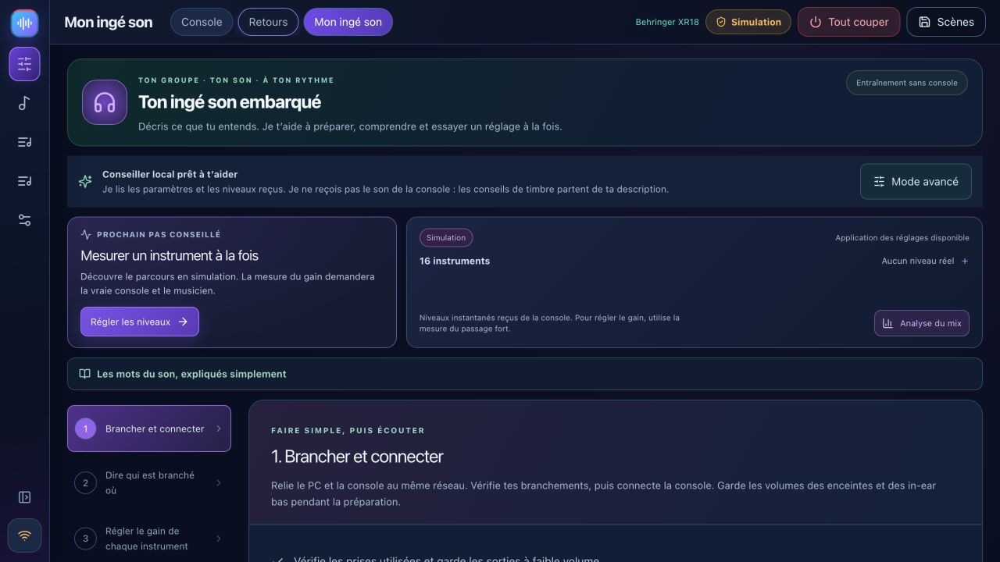
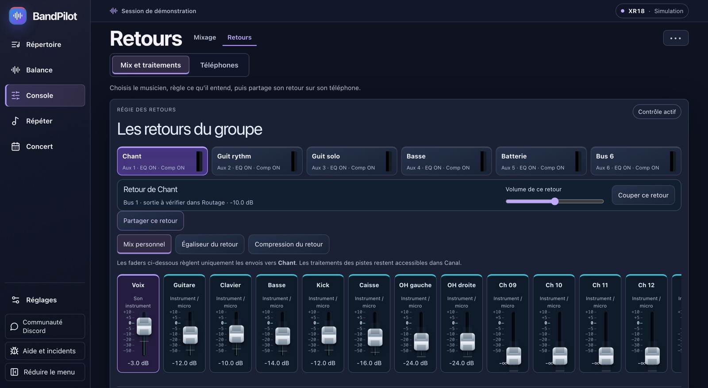
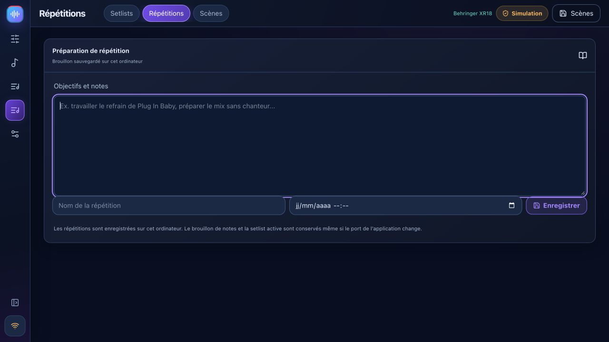

# BandPilot — guida illustrata

[Français](USER_GUIDE_FR.md) · [English](USER_GUIDE_EN.md) · [Deutsch](USER_GUIDE_DE.md) · [Español](USER_GUIDE_ES.md) · [Italiano](USER_GUIDE_IT.md)

## Il tuo primo soundcheck · BandPilot 3.0.0

Sul computer puoi preparare il soundcheck in simulazione, collegare il mixer e condividere i mix monitor del gruppo sulla rete locale.

1. Installa BandPilot e apri la simulazione per esplorare i comandi.
2. Collega il computer e il mixer alla stessa rete locale, poi seleziona il mixer rilevato.
3. Scegli gli strumenti e controlla gli ingressi e le uscite monitor prima di confermare il soundcheck.

Parti da una scena vuota o da una salvata. Quando confermi un nuovo soundcheck con il gruppo, gli ingressi inutilizzati e le rispettive mandate vengono silenziati. Il guadagno dei preamplificatori e l’alimentazione phantom restano invariati.

Assegna un’uscita a ciascun musicista. In Monitor → Telefoni puoi condividere il codice QR per il suo mix sulla rete locale. Salvando la formazione aggiorni i link senza modificare l’audio.

Decidi l’ordine dei brani durante le prove. Sul palco puoi seguire la scaletta e aprire il PDF del brano in corso. Sul computer il bridge REAPER collega i progetti delle prove al repertorio. REAPER va scaricato separatamente.

[Tutorial sul soundcheck guidato](TUTO_MON_INGE_SON_IT.md) · [Note di rilascio](RELEASE_NOTES.md#release-it) · [Matrice di compatibilità dettagliata (FR)](multi-model.md)

Le immagini delle sezioni successive mostrano versioni precedenti. Alcuni comandi hanno cambiato nome o posizione.

## Scegli la tua lingua

Apri **Impostazioni → Opzioni · Lingua** e seleziona **English**, **Français**, **Italiano**, **Español** o **Deutsch**. La modifica è immediata, senza riavviare o modificare le impostazioni audio. La tua scelta viene salvata su questo dispositivo, anche durante i riavvii del desktop. Su un telefono, il selettore si trova nella parte superiore della pagina del monitor personale. I nomi delle canzoni, delle scene e dei musicisti non sono tradotti. Su richiesta è possibile aggiungere altre lingue.

## 1. Installa e conserva i tuoi dati

Utilizzare le [versioni ufficiali](https://herve8940.github.io/BandPilot/it.html#download): Windows `.exe`, Intel Mac `x64.dmg`, Apple Silicon Mac `arm64.dmg`, Linux `.deb` o `.AppImage`. Chiudi la vecchia app prima dell'installazione. Gli identificatori dei dati legacy XR18 Studio vengono conservati; esportare scene importanti prima dell'aggiornamento. I progetti REAPER esistenti non vengono convertiti automaticamente.

Gli installatori potrebbero non essere firmati o non autenticati. Se il sistema operativo blocca un'app, verificane l'origine e leggi il messaggio di sistema. macOS richiede l'autorizzazione di rete locale; Windows potrebbe richiedere l'autorizzazione sulla rete privata appropriata.

## 2. Capacità del modello

| Famiglia | Capacità e status |
|---|---|
| XR18 / X18 / MR18 | 16 canali mono + Aux stereo, 6 uscite Aux, USB multitraccia 18×18. Controlli fisici eseguiti su XR18; altro hardware necessita ancora di convalida. |
| XR12/MR12 | 12 ingressi, 4 preamplificatori microfonici controllabili, 2 uscite Aux fisiche. Registratore stereo su chiavetta USB, nessuna interfaccia USB multitraccia per PC. Profili testati in simulazione; convalida hardware in sospeso. |
| Varianti X32 | **Parziale/sperimentale**: mixer a 32 canali, 16 bus, 8 DCA, 6 matrici, EQ, dinamiche di base e mandate. Il supporto completo per preamplificatore, routing, FX, scena, meter e USB non è disponibile. Il coach e i monitor sul telefono non sono disponibili su X32. |

I bus interni non implicano prese di uscita fisiche. Leggere la [matrice di compatibilità](multi-model.md) prima dell'uso dal vivo. Un profilo rilevato non è la certificazione di ogni funzionalità hardware.

## 3. Simulazione e connessione

In **Réglages / Impostazioni**, scegli un modello simulato e attiva la simulazione. Il badge Simulazione rimane visibile e non vengono inviati comandi del mixer hardware. Le etichette dell'interfaccia negli screenshot sono francesi; questa guida spiega le azioni corrispondenti.

Per l'hardware, metti computer e mixer sulla stessa rete locale e utilizza il rilevamento automatico. L'identità restituita determina marca, modello e porta. Scegli quando rispondono più dispositivi. Le connessioni iniziano in sola lettura. L'immissione manuale dell'IP sonda entrambe le porte del protocollo.

Inizia con **Mixer → PC** per leggere e salvare lo stato del mixer esistente. **PC → Mixer** modifica le impostazioni reali: rivedi l'anteprima e il modello, abbassa i livelli di output e abilita il controllo esplicitamente. Lasciare invariata l'alimentazione phantom a meno che non sia necessaria e confermata separatamente.

## 4. Spazi principali

**Suona** raccoglie console, monitor e **Il mio fonico**. **Prove** funziona con REAPER. **Concerto** segue la scaletta attiva. **Prepara** contiene brani, scalette, prove e scene. **Impostazioni** contiene connessione, account e integrazioni. Riduci il menu laterale per lasciare più spazio al mixer. Sugli schermi piccoli, usa i banchi e lo scorrimento per raggiungere tutti i controlli.

## 5. Controllo del suono guidato

Utilizza il [tutorial in sei fasi](TUTO_MON_INGE_SON_IT.md): collega, descrivi gli ingressi, misura il guadagno, risolvi i problemi, prepara i monitor e salva.

Il coach legge le impostazioni e le misurazioni disponibili, non il tuo flusso audio. Misura ciascun musicista al livello più alto previsto. Esamina i suggerimenti e ascolta prima di accettare. La misurazione del guadagno reale richiede hardware. L'intelligenza artificiale connessa opzionale richiede la tua chiave e Internet; il consulente locale rimane disponibile senza di essa.

## 6. Console semplice ed esperta

Simple offre selezione principale/monitor, volume, mute e solo. Fare clic sul nome di una fonte per le impostazioni dettagliate. I nomi appartengono al mixer o al simulatore; la preparazione del profilo delil coach non rinomina silenziosamente l'hardware.

Expert fornisce visualizzazioni di mixer e canali con preamplificatore, gate, compressore, EQ, mandate e uscita. Le banche espongono bus, Aux, FX e DCA come supportati dal modello. Le impostazioni della simulazione sono dati di allenamento, non risultati acustici.

**Solo in-ear** disattiva e blocca l'audio Principale; l'uscita da questa modalità non ne riattiva automaticamente l'audio. Le modifiche guidate e la preparazione delle scene vuote utilizzano anteprime e backup. I fader diretti agiscono immediatamente quando il controllo è abilitato.

## 7. Monitor personali sul telefono

Prepara i bus pre-fader e scegli le uscite fisiche disponibili sul tuo mixer. Crea ogni musicista con il suo bus, avvia la condivisione locale e fagli scansionare il suo codice QR personale sulla stessa rete. Il collegamento garantisce il controllo del proprio bus: non pubblicarlo. I livelli sono limitati e gli aumenti sono progressivi; mantenere comunque i livelli di ascolto ragionevoli.

I telefoni già aperti seguono le modifiche di sola lettura/controllo senza ricaricare. I profili memorizzano i mix di monitor. La rigenerazione di un collegamento revoca quello vecchio. Interrompi la condivisione quando non viene utilizzato. I monitor dei telefoni X32 non sono supportati in questa versione.

<h2 id="reaper">8. Prove e registrazione REAPER</h2>

1. **Preparare REAPER** — Se richiesto in Prove, installa il bridge incluso in BandPilot e riavvia REAPER. Apri un progetto per scheda con i suoi media. In Prove → Con i miei brani scegli il progetto, verifica ingressi, tracce armate, traccia Originale e fine. REC crea una take separata nel progetto: verifica prima gli ingressi audio reali.

2. **Assegnare il responsabile** — In Monitor → Telefoni crea un link per musicista e assegna il responsabile dalla sua scheda. Sulla stessa rete locale il QR apre Il mio monitor, Il mio brano e Prove. Il ruolo è revocabile. Il responsabile sceglie brano, originale, accompagnamento o take, brano intero o sezione, loop e conteggio disponibili.

3. **Leggere accordi e testi** — Apri Il mio brano sul telefono e scegli Accordi, Testi o Entrambi. La scheda segue progetto e posizione REAPER. Schermo intero e schermo sempre acceso sono facoltativi. Se disponibile, il responsabile verifica la sincronizzazione della scheda sorgente BandStudio prima di condividerla; Tornare alla scheda esportata annulla la scelta. Le schede mancanti non vengono generate automaticamente.

[Tutorial delle novità 2.3.15](NEW_2_3_15_IT.md)

## 9. Scene, note e scalette

**2.3.15 — [Tutorial delle novità 2.3.15](NEW_2_3_15_IT.md)**

La libreria separa scene complete, preset, schede di soundcheck e backup automatici. Include importazione/esportazione JSON, richiamo dei file X-Air .scn supportati e scelta dello slot per i preset FX.

Salvare o importare non modifica il suono. Il richiamo richiede anteprima e conferma, con backup preventivo. I preset di canale conservano gain, alimentazione phantom, livelli, mandate monitor e routing.

Richiamo selettivo di ingressi, uscite ed effetti, protezioni per famiglia di parametri, anteprima e backup. Conversione esplicita di preset e scene portabili entro il perimetro X-Air/M-Air supportato. [Tutorial delle novità 2.3.15](NEW_2_3_15_IT.md)

Una canzone ha bisogno di un titolo. Aggiungi brani alla setlist attiva e salva una setlist con nome. Le note e la setlist attiva vengono archiviate nel database dell'applicazione anche quando cambia la porta locale. Attendi lo stato di bozza salvata prima di chiudere. Le prove con nome rimangono registrazioni separate.

Cattura scene e importa/esporta JSON. I richiami mantengono un backup e richiedono un'anteprima valida; il richiamo guidato esclude l'alimentazione phantom per impostazione predefinita. Le scene tra modelli diversi non vengono convertite automaticamente. I file nativi `.scn` supportati usano ora il richiamo guidato della libreria, con i limiti di modello ed effetti indicati sopra. Le scene complete di X32 non sono disponibili.

## 10. Analisi, spettacoli, resoconti e risoluzione dei problemi

L'analisi X-Air utilizza i livelli hardware disponibili, le misurazioni di spettro e dinamica; esaminare le proposte A/B prima di candidarsi. Lo spettro X32 non è disponibile.

Gli account opzionali separano l'accesso amministratore, musicista bus assegnato e ospite di sola lettura. Nessuna risposta del mixer: controlla i permessi di rete, IP e rete locale/firewall. Telefono non disponibile: controlla condivisione, Wi-Fi e collegamento QR. Bridge non disponibile: installa la versione corrente e riavvia REAPER dopo aver salvato. Eseguire il backup delle scene e dei supporti di progetto prima dell'aggiornamento. La diagnostica include gli IP locali: esaminali prima di pubblicarli pubblicamente.

[Note sulla versione](RELEASE_NOTES.md) · [Correzioni manuali](corrections-tests-manuels.md) · [Compatibilità](multi-model.md) · [Controlli X-Air dettagliati](GUIDE_CONSOLE.md)

## BandPilot 2.3.1

**Riparti dall’ultimo soundcheck riuscito.** Associa una scena completa e le note a ogni gruppo e verifica le modifiche prima del richiamo. Dal telefono, i musicisti possono controllare bus e segnale e richiamare l’ultimo mix. Il Laboratorio del suono aggiunge il confronto A/B tra cassa e basso. La diagnostica distingue rete, controllo e ponte REAPER.

[Note di rilascio](RELEASE_NOTES.md)

### Scheda tecnica e planimetria

Schede dei musicisti, lista cablaggi e planimetria stampabile riprendono gli ingressi e i monitor del gruppo.

## Convalida degli strumenti e assistenza (2.3.2–2.3.3)

Salvare il gruppo prepara il profilo; le modifiche audio guidate richiedono anteprima e conferma. In caso di errore, leggi il messaggio, chiudi la finestra e prepara una nuova proposta. Le modifiche interrotte conservano una copia per l’annullamento guidato. Misura di nuovo il guadagno dopo aver sostituito uno strumento. Il recupero degli effetti legge il mixer e trasferisce il collegamento solo se modello, effetto e parametri corrispondono; archiviare un collegamento non cambia il mixer.

Il collegamento alla scheda tecnica apre le schede dei musicisti e la pianta stampabile. I rapporti possono essere controllati, salvati localmente o pubblicati esplicitamente su GitHub: le issue sono pubbliche. La ricerca di aggiornamenti all’avvio propone il download senza imporre l’installazione. Consulta la pagina sulla privacy per le richieste esterne.

## Sostieni BandPilot

Il sostegno volontario aiuta a dedicare tempo alle correzioni, alle prove sui mixer e alle guide in cinque lingue. Anche segnalazioni, traduzioni e condivisioni sono utili.

[Come aiutare il progetto](SUPPORT_IT.md) · [Dati e privacy (FR / EN)](PRIVACY.md)

## Suonare dal vivo

Apri i progetti in REAPER. In **Prove**, scegli **Prepara la scaletta**. Aggiungi i brani desiderati. In **Scaletta** ordina i brani e i bis, poi scegli **Apri il concerto**. Avanti passa al brano seguente. Puoi avviare separatamente accompagnamento, originale o take e aprire il PDF allegato al brano.
