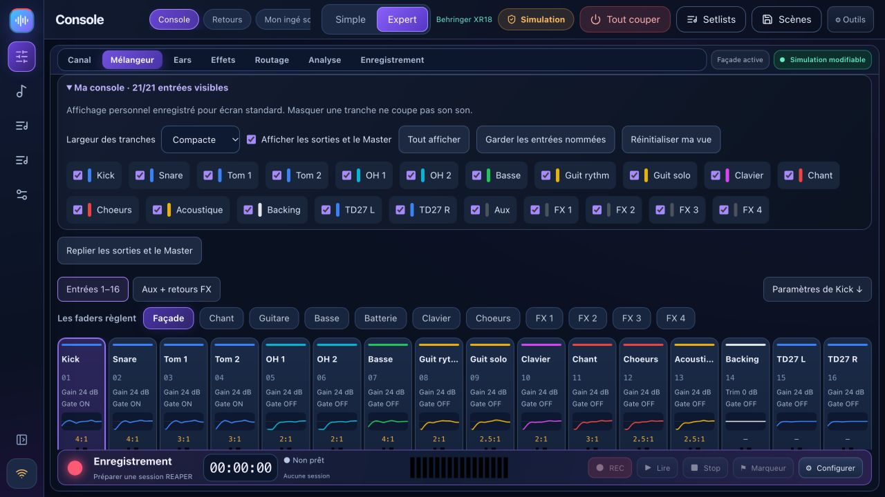

# Console personnelle et régie des retours

## Ma console

Dans **Console → Expert → Mélangeur**, ouvre **Ma console**. Choisis les tranches à afficher, la largeur compacte ou confortable et la visibilité des sorties/Master. « Garder les entrées nommées » sélectionne les pistes dont le nom diffère du nom par défaut ; ce bouton ne détecte pas automatiquement une activité audio.

Masquer ne coupe pas le son et ne change aucun paramètre de console. « Tout afficher » restaure les tranches. Le panneau des sorties possède toujours un bouton pour le rouvrir. Les paramètres complets du canal sélectionné restent accessibles sous le mélangeur.

La disposition est sauvegardée localement dans ce navigateur/application, séparément pour chaque modèle et pour les classes d’écran : moins de 760 px, 760 à 1399 px, 1400 px et plus. Elle ne suit pas automatiquement un autre ordinateur. « Réinitialiser ma vue » rétablit la disposition de la classe courante.

## Régie des retours

Depuis **Retours → Ouvrir la régie des retours**, ou **Console → Expert → Ears** :

1. Choisis le musicien ou le bus. Les noms et instruments attribués viennent de Mon ingé son ; les noms de la console servent de repli.
2. **Mix personnel** : les faders contrôlent uniquement les envois vers ce bus. Les instruments attribués au musicien sont surlignés.
3. **Égaliseur du retour** : règle l’EQ à six bandes du bus. Il agit sur le mix entier de ce retour.
4. **Compression du retour** : accède aux paramètres existants et à la réduction de gain si la console fournit une mesure récente. « — » signifie qu’aucune mesure n’est disponible.
5. Ouvre **Comprendre le trajet vers ce retour** pour lire la source physique/USB et le point de prélèvement de chaque canal : entrée, avant/après EQ, avant/après fader ou sous-groupe. La sortie physique effective dépend du routage.

Les vumètres des captures ne représentent pas un signal matériel. Les réglages restent désactivés en lecture seule. La nouvelle régie ne modifie ni la façade ni les autres bus lorsqu’on règle l’EQ ou la compression du bus sélectionné. Aucun préréglage n’est appliqué à l’ouverture.

La **matrice complète** reste disponible sous la régie, avec les envois existants et les bus internes. La sélection personnelle affiche les sorties de retour physiques : deux sur XR12/MR12, six sur XR18/MR18/X18. Les bus internes ne sont pas présentés comme des prises physiques supplémentaires.

Cette évolution concerne la console X-Air/M-Air. Le mélangeur X32 conserve son interface et ses limites expérimentales documentées. Elle n’ajoute pas d’EQ dynamique.

## REAPER : mettre à jour les deux côtés

La version 2.2.2 inclut le pont **1.2.3**. Dans **Répéter**, installe le pont, sauvegarde tes projets et redémarre REAPER. Mettre à jour l’application seule ne remplace pas le script déjà actif. Les échanges sont isolés entre instances, REC/Stop passent avant les formes d’onde et les verrous temporaires sont retentés sans rejouer REC. Voir le [rapport du correctif](hotfix-2.2.2.md).

## English

Open **Console → Expert → Mélangeur → Ma console** to choose visible strips, compact/comfortable widths and output/Master visibility. Hiding changes only the display. Layouts are stored locally per mixer model and screen class; they do not sync between computers. “Keep named inputs” uses names, not audio activity.

Open **Retours → Ouvrir la régie des retours**, or **Expert → Ears**, to select a musician/bus and access personal sends, six-band bus EQ and bus compression. Assigned instruments are highlighted. EQ/compression affect the selected bus mix, while source processing remains in the channel view. Gain reduction is shown only when available. The complete send matrix and internal buses remain accessible below.

Physical monitor selection respects the model: two outputs on XR12/MR12 and six on XR18/MR18/X18. This feature is for X-Air/M-Air; X32 remains a separate experimental adapter. No dynamic EQ or automatic processing is added.

Update the REAPER bridge to **1.2.3** from Rehearse, save projects and restart REAPER. Version 2.2.2 protects concurrent clients and transient file locks and prioritizes transport. Windows locking is covered by simulated regressions; validation on the affected Windows hardware remains necessary.
